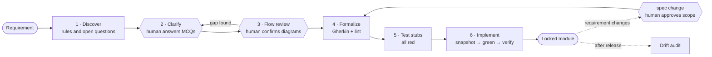

<div align="center">

# SpecEngine

**Stepwise refinement from requirements to test code, enforced for AI coding agents.**

SpecEngine is a Claude Code plugin that never lets an agent jump from a requirement straight to tests. It lowers the requirement one level of abstraction at a time, down to step definitions and test code. Humans fill every gap, scripts check every level, and no lower level can rewrite the one above it.

[](CHANGELOG.md)
[](LICENSE)
[](#installation)
[](#requirements)
[](scripts/)

English · [繁體中文](README.zh-TW.md)

</div>

---

## The problem

Coding agents fail in two well-documented ways.

1. **They fill gaps with guesses.** A four-sentence requirement leaves dozens of boundaries open. The agent picks an answer for each one and you discover the wrong picks at acceptance.
2. **They edit the test instead of the code.** When a test and the implementation disagree, the cheapest path to green is to change the test. The report still says "all tests pass".

Specification-driven tools such as GitHub Spec Kit and Kiro address the first problem by writing a specification before coding. The agent then derives the tests from that specification largely on its own, and nothing locks the specification or the tests while the code is written.

## The approach: stepwise refinement

SpecEngine does not translate a natural-language specification into tests in one move. It refines the requirement through six levels, from the stakeholder's words down to test code. Each level is a file you can read, each answers one question, and each is checked before the next one is written.

| Level | Artifact | Question it answers | Checked by |
| :--- | :--- | :--- | :--- |
| 1 | Natural-language requirement | What does the stakeholder want? | Human |
| 2 | Rule matrix | Under which precondition, on which trigger, must the system do what? | Human answers every open question; `feature-lint.js` checks the structure |
| 3 | Flow diagrams | Do the rules together cover every branch? | Human confirms; any gap goes back to level 2 |
| 4 | Gherkin scenarios and example tables | What are the concrete cases for each rule? | `feature-lint.js`: one-to-one rule coverage; every example row must follow from the matrix |
| 5 | Step sentences and driver interface | Which system operation does each sentence drive? | In driver mode every `@binds` must point to a real driver method; sentences are frozen |
| 6 | Step implementations and product code | How is it done? | Tests go from red to green while levels 2 to 5 stay byte-for-byte unchanged |

Refining in levels gives two things a one-step translation cannot:

- **Each error is caught at the level where it is made.** An unclear requirement becomes a question at level 2. A missing branch shows up in the diagrams at level 3. A miscopied example fails the lint at level 4. In a one-step translation all three surface later as the same symptom, a failing test, with nothing to say which level went wrong.
- **Every test line is traceable to a decision.** A step implementation leads to its sentence, its scenario and its rule, and from there to the question it came from and the person who answered it.

### Established theory, put into practice

None of the ideas underneath SpecEngine is new on its own. Its contribution is turning them into one working toolchain for AI coding agents.

| Idea | Source | Where it lives in SpecEngine |
| :--- | :--- | :--- |
| Stepwise refinement | Wirth, *Program Development by Stepwise Refinement*, 1971 | The six levels above |
| Preconditions and postconditions | Hoare, *An Axiomatic Basis for Computer Programming*, 1969 | Each rule in the matrix is a precondition, a trigger and a postcondition |
| Behaviour-driven development and specification by example | North, 2006; Adzic, 2011 | Gherkin scenarios with example tables as the executable level |
| Test-driven development | Beck, 2002 | Every test starts red; code is written until it turns green |

On top of that foundation SpecEngine adds two rules that classic refinement never needed, because its refiner was a human:

1. **Gaps between levels are filled only by humans.** Whenever a level cannot be derived from the one above, the agent must stop and ask. Every answer is filed with the rule it produced.
2. **A lower level cannot rewrite a higher one.** While the agent writes levels 5 and 6, a script holds levels 2 to 5 frozen. Once the module is done it is locked, and any later change must go through the change workflow.

### What holds it together

| Principle | Mechanism |
| :--- | :--- |
| **Humans decide, agents ask** | Every unresolved boundary becomes a multiple-choice decision that only a human may answer. |
| **The target cannot move** | Before implementation, a script snapshots the specification, every step sentence and the driver interface. Afterwards it compares them byte for byte, and any change fails the run. |
| **Done means locked** | A completed module gets a lock file in version control. A later audit reports any change made outside the change workflow to the specification, the rule matrix, the shared glossary or the data model. |
| **State is derived, not declared** | A module's stage is computed from which artifacts exist, so a stale status field cannot mislead the agent or the team. |

All enforcement scripts use only the Node.js standard library.

## Workflow



Hexagons are human gates. The agent stops there and waits.

| Stage | Command | Who acts | Output |
| :--- | :--- | :--- | :--- |
| Onboarding | `spec manifest sync` | Agent, then human for missing fields | `architecture-manifest.md`: language, test command, directories |
| 1 Discover | `spec 01` | Agent | Rule matrix draft, data model draft, question queue |
| 2 Clarify | `spec 02` | **Human** | Decisions written back into the matrix |
| 3 Flow review | `spec flow-align` | **Human** | Confirmed flow diagrams; gaps go back to stage 2 |
| 4 Formalize | `spec 03` | Agent | `.feature` files that pass `feature-lint.js` |
| 5 Test stubs | `spec 04` | Agent | Step definitions and driver interface, all failing |
| 6 Implement | `spec 05` | Agent | Product code, `spec-guard.js verify` pass, module lock |
| Change | `spec change` | Agent, **human approves** | Classified change record, re-lock, untouched rules verified unchanged |
| Audit | `spec 06` | Agent, read-only | Drift report: lock, schema and rule coverage |
| Status | `spec status` | Script | Stage, open questions and next step for every module |

`spec run` chains stages 1 to 6 and starts from wherever the module currently is.

## Evidence

### Controlled comparison

Three requirements of increasing difficulty were implemented under three conditions with the same base project and the same stakeholder answer sheet. Most runs used Claude Fable 5.1. T3 runs that were resumed or repeated after a model switch used Claude Opus 5.5. Results were scored by hidden acceptance tests that the agent never saw. The table counts only clean runs.

| Requirement | No SDD tool | GitHub Spec Kit | SpecEngine 2.0 |
| :--- | :---: | :---: | :---: |
| T1 Loyalty-point redemption (18 tests) | 11, 11 | 18, 18 | 18, 18 |
| T2 Order state machine (32 tests) | 20, 20 | 32, 32 | 32, 32 |
| T3 Multi-tenant coupons (38 tests) | 20, 22 | 36, 38 | 38 |

| Tamper test: one value changed in a locked specification | Result |
| :--- | :--- |
| SpecEngine | **8 of 8** detected by `spec-guard.js audit` in under a second |
| GitHub Spec Kit | 1 of 2 detected by `converge`; a changed threshold was noted but still reported as converged |
| No SDD tool | No mechanism; tests kept passing |

What the numbers say:

- **Both SDD tools beat the baseline by a wide margin.** Without one, the agent guessed every error code wrong, and on T3 it also guessed behaviour wrong.
- **Accuracy was a tie between Spec Kit and SpecEngine.** SpecEngine asked about every open boundary in T2. Spec Kit's clarify step caps each round at five questions and missed one boundary in one T3 run.
- **SpecEngine's advantage is enforcement.** Its guarantees come from scripts, so they hold regardless of which model runs the workflow.
- **SpecEngine costs more time.** Runs took about 1.4 to 1.6 times as long as Spec Kit and stopped for human input more often.

Each cell holds one or two runs, so differences of one or two tests are not meaningful. Three T3 runs were discarded after the agent read the answer sheet, and clean runs were repeated with answers supplied by a separate session. Requirements, answer sheets, hidden tests, every run's output and the scoring scripts are in [`benchmark/`](benchmark/README.md), and every number above can be regenerated from them.

### Change workflow (2.1.0)

Thirteen change scenarios passed their hidden acceptance tests. The scenarios covered parameter changes, behaviour changes, new rules, vague requests, a behaviour change disguised as a small tweak, and resumption in a fresh session. Under the same instructions, the 2.0 control changed the specification without asking for approval whenever the change request said "all other rules unchanged".

### Case study

A four-sentence requirement became 11 human decisions and 21 passing scenarios. One scenario failed because the agent had copied an example wrongly into the Gherkin. The agent reported the defect instead of editing the frozen specification. The full replication package is in [`case-study/`](case-study/README.md).

## Installation

Inside Claude Code:

```text
/plugin marketplace add https://github.com/yi-luan/specengine-plugin
/plugin install specengine@specengine-marketplace
```

To upgrade:

```text
/plugin marketplace update specengine-marketplace
```

### Requirements

- Claude Code
- Node.js 18 or later on the `PATH`
- A git repository and a BDD test runner declared in the manifest. The workflow has been run end to end with cucumber-js.

## Quick start

**1. Onboard a project.** In your repository, tell Claude:

> Set up SpecEngine for this project

It scans the project, writes `.claude/spec/architecture-manifest.md` and asks only for fields it could not determine.

**2. Build a feature.** Paste the requirement and say:

> spec run

The agent works through the stages and stops only at the human gates.

**3. Change a finished feature.**

> Requirement change: raise the redemption cap from 30% to 35%

The change is classified as a parameter change, a behaviour change or a new rule, and only the stages that class needs are run. You approve the scope before the specification changes. Afterwards a script checks that every rule outside the approved scope is byte-for-byte unchanged.

**4. Check progress at any time.**

> spec status

Add `.specengine/sdd/.spec-guard-snapshot.json` to `.gitignore`. Everything else under `.specengine/` belongs in version control.

## What is enforced, and how

| Guarantee | Enforced by | Strength |
| :--- | :--- | :--- |
| Unresolved questions are not answered by the agent | Stage instructions | Prompt-level |
| Human gates actually stop | Stage instructions | Prompt-level |
| Gherkin structure and one-to-one rule coverage | `feature-lint.js` | Script |
| Specification, step sentences and driver interface frozen during implementation | `spec-guard.js snapshot / verify` | Script |
| Completed modules not changed outside the change workflow | `spec-guard.js lock / audit` | Script |
| Changes approved, scoped and recorded | `spec-change.js` | Script |
| Module stage | `spec-status.js` | Script |

Prompt-level rules held in the runs above, but no script guarantees them. Script-level guarantees cannot be bypassed by the agent.

## Project layout

```text
specengine-plugin/
├── skills/        11 workflow stages, one SKILL.md each
├── scripts/       feature-lint, spec-guard, spec-change, spec-status (Node.js, no dependencies)
├── docs/          contract-rules.md: the format of every artifact
├── templates/     manifest and CLAUDE.md section used during onboarding
├── benchmark/     comparison against Spec Kit and a no-tool baseline, with every run and the scoring scripts
├── case-study/    replication package for the paper
└── paper/         paper source (LaTeX) and PDF

your-project/  (after onboarding)
├── .claude/spec/architecture-manifest.md
└── .specengine/
    ├── spec/      specification contract: features, data model, glossary, conventions, exclusions
    └── sdd/       process state: rule matrix, questions, decisions, flow diagrams, locks, change records
```

## Limitations

- **Tests are examples, not proofs.** A table with three values does not prove the fourth.
- **Step-sentence freezing recognises call-style step definitions** such as `Given('…', fn)` in cucumber-js and Cucumber-JVM. Decorator-based frameworks such as pytest-bdd, behave and Reqnroll are not yet detected.
- **Stage instructions are written in Traditional Chinese**, and so are the generated artifacts. Identifiers in generated code follow the manifest setting.
- **The approach costs human attention.** For a trivial change it is more process than the change needs.

## Paper

The design and case study are described in:

> Allen Tsai. *Constraining LLM-Assisted Behavior-Driven Development with Externally Enforced Specification Contracts: Design and Case Study of SpecEngine.* 2026. Source in [`paper/`](paper/).

```bibtex
@misc{tsai2026specengine,
  author = {Tsai, Allen},
  title  = {Constraining {LLM}-Assisted Behavior-Driven Development with Externally
            Enforced Specification Contracts: Design and Case Study of {SpecEngine}},
  year   = {2026},
  note   = {Manuscript}
}
```

## License

[MIT](LICENSE). Release notes are in [CHANGELOG.md](CHANGELOG.md).
