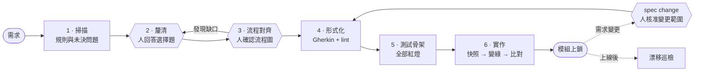

<div align="center">

# SpecEngine

**給 AI 寫程式代理用的可執行、雜湊凍結規格契約。**

SpecEngine 是一個 Claude Code plugin。它讓代理遇到需求沒講清楚的地方先問人，不自己猜；也讓雙方說定的規格在寫程式期間無法被悄悄改掉。

[](CHANGELOG.md)
[](LICENSE)
[](#安裝)
[](#環境需求)
[](scripts/)

[English](README.md) · 繁體中文

</div>

---

## 要解決的問題

AI 寫程式代理有兩種已被反覆記錄的失敗模式。

1. **用猜的補洞。** 四句話的需求留下幾十個沒講的邊界，代理每一個都自己選答案，選錯的要到驗收才發現。
2. **改測試而不是改程式。** 測試和實作對不上時，最省事的變綠方法是改測試，回報照樣寫「全部通過」。

GitHub Spec Kit 這類規格驅動工具用「寫程式前先寫規格」處理第一個問題，但它們的規格仍是文字。驗收條件不會被執行，測試要由代理自己推導，實作期間也沒有任何機制阻止規格被改。

## 做法

SpecEngine 把規格當成由腳本強制執行的契約，而不是交代代理遵守的文件。

| 原則 | 機制 |
| :--- | :--- |
| **人決定，代理提問** | 每個未決邊界變成一題選擇題，只有人能回答。答案寫回規則矩陣，矩陣欄位對應 Hoare 三元組：前置條件、觸發事件、後置斷言。 |
| **規則編譯成測試** | 確認過的規則轉成 Gherkin 情境，經 lint 檢查結構與「規則和情境一一對應」，再透過一層薄的 Driver 介面綁到 Step Definitions。 |
| **靶不能移動** | 實作前，腳本對規格、每個 Step 句型和 Driver 介面拍下快照；實作後逐字節比對，有任何改動就判失敗。 |
| **完工即上鎖** | 完成的模組產生一個進版本控制的 lock 檔。之後巡檢會回報所有未經變更流程的改動，範圍包含規格、規則矩陣、共用術語與資料模型。 |
| **狀態用推導，不用宣告** | 模組所在階段由現有產物推算，過期的狀態欄位騙不了代理，也騙不了團隊。 |

所有強制腳本只用 Node.js 標準函式庫。

## 流程



六角形是人工關卡，代理會停在那裡等人。

| 階段 | 指令 | 誰動手 | 產出 |
| :--- | :--- | :--- | :--- |
| 導入 | `spec manifest sync` | 代理掃描，缺的欄位問人 | `architecture-manifest.md`：語言、測試指令、目錄 |
| 1 掃描 | `spec 01` | 代理 | 規則矩陣草稿、資料模型草稿、待答問題佇列 |
| 2 釐清 | `spec 02` | **人** | 決策寫回矩陣 |
| 3 流程對齊 | `spec flow-align` | **人** | 確認過的流程圖；有缺口退回第 2 站 |
| 4 形式化 | `spec 03` | 代理 | 通過 `feature-lint.js` 的 `.feature` 檔 |
| 5 測試骨架 | `spec 04` | 代理 | Step Definitions 與 Driver 介面，全部紅燈 |
| 6 實作 | `spec 05` | 代理 | 產品程式碼、`spec-guard.js verify` 通過、模組 lock |
| 變更 | `spec change` | 代理，**人核准** | 分類過的變更紀錄、重新上鎖、範圍外規則逐字未動的證明 |
| 巡檢 | `spec 06` | 代理，唯讀 | 漂移報告：lock、資料表結構、規則覆蓋率 |
| 狀態 | `spec status` | 腳本 | 每個模組的階段、待答題數、下一步 |

`spec run` 會串起第 1 到第 6 站，並從模組目前所在的位置開始。

## 實證

### 對照實驗

三個難度遞增的需求，在三種條件下各自實作。三種條件用同一個基準專案、同一份需求方標準答案表，結果由代理看不到的隱藏驗收測試評分。大部分回合使用 Claude Fable 5.1；T3 在切換模型後續跑或補跑的回合使用 Claude Opus 5.5。下表只計乾淨回合。

| 需求 | 不用 SDD 工具 | GitHub Spec Kit | SpecEngine 2.0 |
| :--- | :---: | :---: | :---: |
| T1 會員點數折抵（18 條測試） | 11、11 | 18、18 | 18、18 |
| T2 訂單狀態機（32 條測試） | 20、20 | 32、32 | 32、32 |
| T3 多租戶優惠券（38 條測試） | 20、22 | 36、38 | 38 |

| 偷改測試：在已上鎖的規格中改掉一個值 | 結果 |
| :--- | :--- |
| SpecEngine | **7 次全部**被 `spec-guard.js audit` 在一秒內抓到 |
| GitHub Spec Kit | `converge` 2 次抓到 1 次；改掉的門檻值有被提到，但仍判定已收斂 |
| 不用 SDD 工具 | 沒有機制，測試照樣通過 |

這些數字的意思：

- **兩套 SDD 工具都大幅勝過基準。** 不用工具時，代理把每個失敗原因碼都猜錯，T3 連行為也猜錯。
- **Spec Kit 和 SpecEngine 的精準度打平。** SpecEngine 在 T2 問到了每個未決邊界。Spec Kit 的 clarify 每輪最多 5 題，在 T3 的一個回合漏問了一個邊界。
- **SpecEngine 的優勢在強制力。** 它的保證來自腳本，不論哪個模型執行流程都成立。
- **SpecEngine 比較花時間。** 耗時約為 Spec Kit 的 1.4 到 1.6 倍，停下來等人的次數也較多。

每格只有一到兩個回合，相差一兩條測試不代表優劣。T3 有三個回合因代理讀到答案表而作廢，改由另一個 session 回答後重跑乾淨回合。評測素材尚未放進本 repo。

### 需求變更流程（2.1.0）

13 組變更情境全部通過隱藏驗收。情境涵蓋：只改參數、改既有行為、新增規則、模糊的需求、偽裝成小調整的行為變更、中斷後在新 session 續跑。同樣的指示下，2.0 對照組只要遇到變更單寫「其他規則不變」，就會不經核准直接改規格。

### 個案研究

四句話的需求產生 11 個人工決策和 21 個通過的情境。其中一個情境失敗，原因是代理把範例抄錯進 Gherkin。代理回報了這個瑕疵，沒有去改已凍結的規格。完整重現包在 [`case-study/`](case-study/README.md)。

## 安裝

在 Claude Code 中執行：

```text
/plugin marketplace add https://github.com/yi-luan/specengine-plugin
/plugin install specengine@specengine-marketplace
```

升級：

```text
/plugin marketplace update specengine-marketplace
```

### 環境需求

- Claude Code
- `PATH` 上有 Node.js 18 以上
- 一個 git repo，以及在 manifest 中宣告的 BDD 測試框架。目前完整跑通過的是 cucumber-js。

## 快速開始

**1. 導入專案。** 在你的 repo 裡對 Claude 說：

> 幫我把 SpecEngine 導入這個專案

它會掃描專案、寫出 `.claude/spec/architecture-manifest.md`，只問它查不到的欄位。

**2. 開發一個功能。** 貼上需求並說：

> spec run

代理會依序跑完各站，只在人工關卡停下來。

**3. 修改已完成的功能。**

> 需求變更：折抵上限從 30% 改成 35%

變更會先被分成三類：只改參數、改既有行為、新增規則，再只跑該類需要的站。規格改動前要你核准範圍。改完後，腳本會檢查範圍外的每條規則逐字未動。

**4. 隨時查看進度。**

> spec status

請把 `.specengine/sdd/.spec-guard-snapshot.json` 加進 `.gitignore`。`.specengine/` 底下其餘檔案都應進版本控制。

## 什麼被強制、怎麼強制

| 保證 | 執行者 | 強度 |
| :--- | :--- | :--- |
| 未決問題不由代理代答 | 各站指示 | 提示詞層級 |
| 人工關卡確實停下 | 各站指示 | 提示詞層級 |
| Gherkin 結構與規則一一覆蓋 | `feature-lint.js` | 腳本 |
| 實作期間規格、Step 句型、Driver 介面凍結 | `spec-guard.js snapshot / verify` | 腳本 |
| 完工模組只能經變更流程修改 | `spec-guard.js lock / audit` | 腳本 |
| 變更經核准、有範圍、有紀錄 | `spec-change.js` | 腳本 |
| 模組階段 | `spec-status.js` | 腳本 |

提示詞層級的規則在上述回合中都有遵守，但沒有腳本保證。腳本層級的保證，代理繞不過去。

## 目錄結構

```text
specengine-plugin/
├── skills/        11 個流程階段，各一份 SKILL.md
├── scripts/       feature-lint、spec-guard、spec-change、spec-status（Node.js，無相依套件）
├── docs/          contract-rules.md：所有產物的格式規範
├── templates/     導入時用的 manifest 與 CLAUDE.md 區塊範本
├── case-study/    論文個案的重現包
└── paper/         論文原始檔（LaTeX）與 PDF

你的專案（導入後）
├── .claude/spec/architecture-manifest.md
└── .specengine/
    ├── spec/      規格契約：feature、資料模型、術語、慣例、刻意不做清單
    └── sdd/       流程狀態：規則矩陣、待答題、決策、流程圖、lock、變更紀錄
```

## 限制

- **測試是例子，不是證明。** 表格列了三個值，不代表第四個值一定對。
- **Step 句型凍結只認呼叫式寫法**，例如 cucumber-js、Cucumber-JVM 的 `Given('…', fn)`。pytest-bdd、behave、Reqnroll 這類裝飾器寫法目前偵測不到。
- **各站指示以繁體中文撰寫**，產出的規格產物也是繁體中文。程式碼識別字的語言依 manifest 設定。
- **這套流程要花人的注意力。** 很小的改動用它會顯得流程比改動還重。

## 論文

設計與個案研究見：

> Allen Tsai. *Constraining LLM-Assisted Behavior-Driven Development with Externally Enforced Specification Contracts: Design and Case Study of SpecEngine.* 2026. 原始檔在 [`paper/`](paper/)。

```bibtex
@misc{tsai2026specengine,
  author = {Tsai, Allen},
  title  = {Constraining {LLM}-Assisted Behavior-Driven Development with Externally
            Enforced Specification Contracts: Design and Case Study of {SpecEngine}},
  year   = {2026},
  note   = {Manuscript}
}
```

## 授權

[MIT](LICENSE)。版本變更見 [CHANGELOG.md](CHANGELOG.md)。
