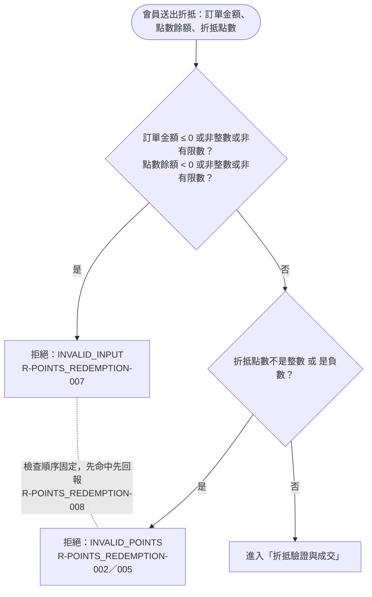

# 輸入驗證

會員送出折抵請求後，系統先檢查三個輸入（訂單金額、點數餘額、折抵點數）是否合法；不合法即拒絕，並依固定順序回報第一個命中的失敗原因。

## rule_id
- R-POINTS_REDEMPTION-007（訂單金額／點數餘額非法 → INVALID_INPUT）
- R-POINTS_REDEMPTION-002（折抵點數非整數 → INVALID_POINTS）
- R-POINTS_REDEMPTION-005（折抵點數負數 → INVALID_POINTS）
- R-POINTS_REDEMPTION-008（多錯誤固定順序）

## 流程圖

## 白話複述
1. 訂單金額是 0、負數、帶小數或不是有限數；或點數餘額是負數、帶小數或不是有限數 → 拒絕，原因 INVALID_INPUT（R-POINTS_REDEMPTION-007）
2. 折抵點數不是整數（例如 10.5 點）→ 拒絕，原因 INVALID_POINTS（R-POINTS_REDEMPTION-002）
3. 折抵點數是負數 → 拒絕，原因 INVALID_POINTS（R-POINTS_REDEMPTION-005）
4. 同時踩到多個錯誤 → 依 INVALID_INPUT → INVALID_POINTS → INSUFFICIENT_POINTS → EXCEEDS_LIMIT 回報第一個（R-POINTS_REDEMPTION-008）

## 已知取捨
- 本模組為純函式，不存取資料庫；餘額持久化由呼叫端負責（X-POINTS_REDEMPTION-001）

## 確認時間
- 第 1 次 2026-10-20 02:11：使用者確認圖無不一致，惟疑似缺口 (a) 待補問
- 第 2 次 2026-10-20 02:13：R-007 擴充後重畫，使用者回覆「確認」
