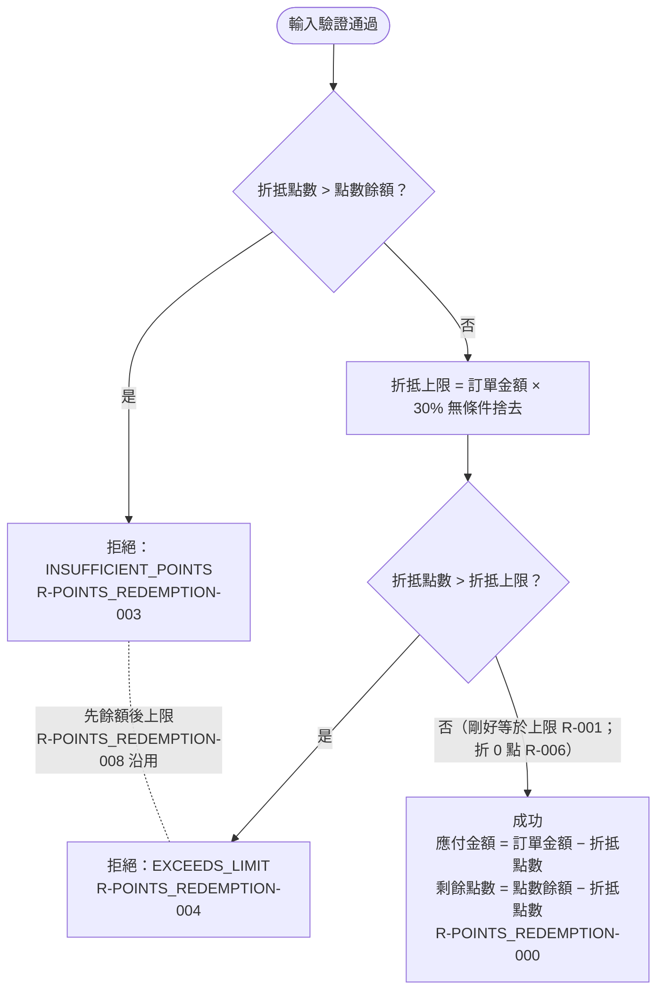

# 折抵驗證與成交

輸入合法後，系統依序檢查點數是否足夠、是否超過 30% 折抵上限；都通過則折抵成功，回傳折抵後的應付金額與剩餘點數。

## rule_id
- R-POINTS_REDEMPTION-003（點數不足 → INSUFFICIENT_POINTS）
- R-POINTS_REDEMPTION-004（超過上限 → EXCEEDS_LIMIT）
- R-POINTS_REDEMPTION-001（剛好等於上限 → 成功）
- R-POINTS_REDEMPTION-006（折 0 點 → 成功，金額不變、點數不扣）
- R-POINTS_REDEMPTION-000（主流程成功）
- R-POINTS_REDEMPTION-008（沿用：先餘額後上限）

## 流程圖

## 白話複述
1. 折抵點數比餘額多 → 整筆拒絕，原因 INSUFFICIENT_POINTS，不自動折到餘額用完（R-POINTS_REDEMPTION-003）
2. 折抵點數超過上限（訂單金額 × 30% 無條件捨去）→ 整筆拒絕，原因 EXCEEDS_LIMIT，不自動截斷（R-POINTS_REDEMPTION-004）
3. 折抵點數剛好等於上限 → 成功（R-POINTS_REDEMPTION-001）
4. 折抵 0 點 → 成功，應付金額＝訂單金額、剩餘點數＝點數餘額（R-POINTS_REDEMPTION-006）
5. 點數夠、沒超過上限 → 成功，應付金額＝訂單金額 − 折抵點數，剩餘點數＝點數餘額 − 折抵點數（R-POINTS_REDEMPTION-000）
6. 同時點數不足且超過上限 → 回報 INSUFFICIENT_POINTS（R-POINTS_REDEMPTION-008 沿用）

## 已知取捨
- 本模組為純函式，不存取資料庫；餘額持久化由呼叫端負責（X-POINTS_REDEMPTION-001）

## 確認時間
- 第 1 次：使用者確認無不一致；第 2 次 2026-10-20 02:13：沿用，使用者回覆「確認」
