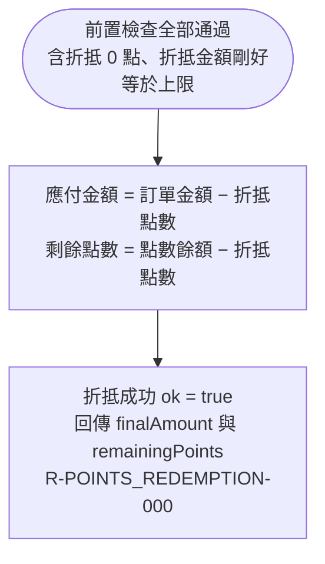

# 折抵成交與結果回傳

前置檢查全部通過後計算應付金額與剩餘點數並回傳成功結果。折抵 0 點亦走此流程（等同沒折抵）。

## rule_id
- R-POINTS_REDEMPTION-000（主幹成功流程）
- R-POINTS_REDEMPTION-002（沿用：最後一道閘門，等於上限可通過）

## 流程圖

## 白話複述
5. 全部通過（含折抵 0 點）→ 成功，應付金額 = 訂單金額 − 折抵點數，剩餘點數 = 餘額 − 折抵點數（R-POINTS_REDEMPTION-000）

## 已知取捨
- X-POINTS_REDEMPTION-001：本模組只回傳剩餘點數，不實際扣款持久化

## 確認時間
2026-10-20 02:12（使用者回覆「確認」）
