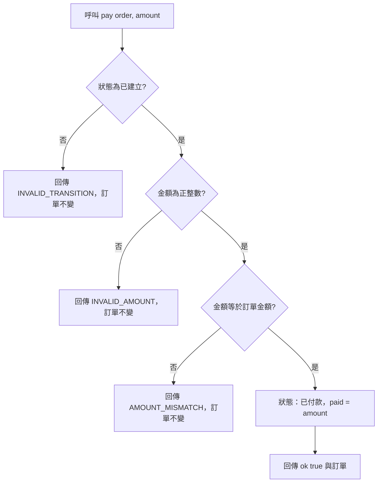

# 付款

- Rule：R-ORDER_STATE_MACHINE-003、004、010（非法狀態部分）、011（付款金額部分）
- 確認時間：2026-10-31 23:32

白話複述：
1. 只有已建立的訂單可以付款；成功後為已付款，已付金額等於付款金額（R-ORDER_STATE_MACHINE-003）。
2. 金額正整數但不等於訂單金額時回傳 AMOUNT_MISMATCH（R-ORDER_STATE_MACHINE-004）。
3. 非已建立的訂單付款回傳 INVALID_TRANSITION（R-ORDER_STATE_MACHINE-010）；金額非正整數回傳 INVALID_AMOUNT（R-ORDER_STATE_MACHINE-011）。

已知取捨：無。
