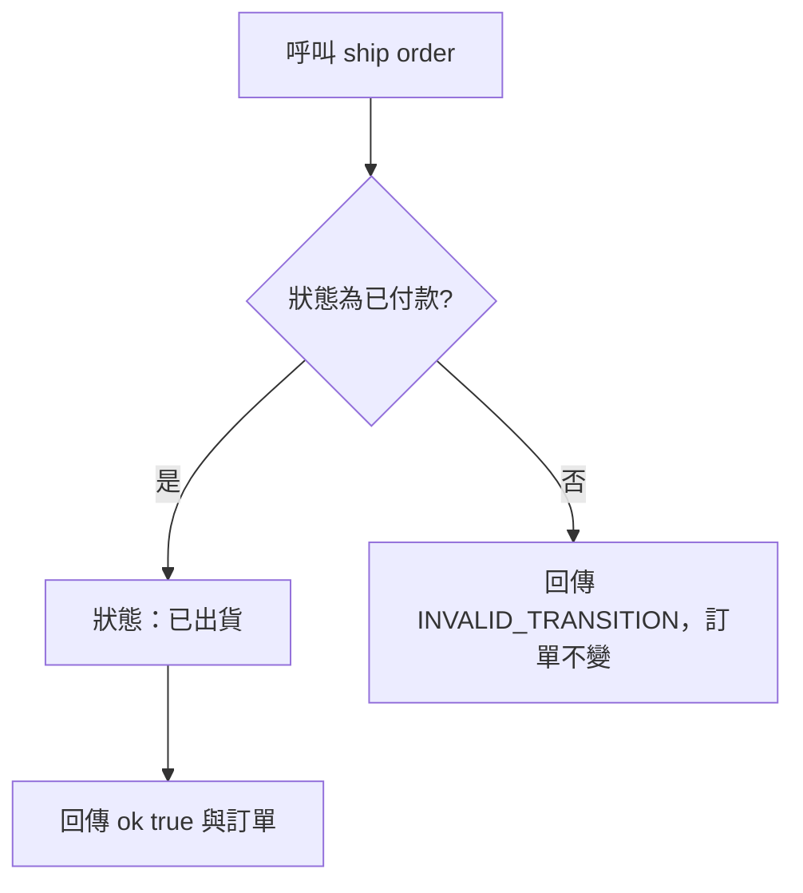

# 出貨

- Rule：R-ORDER_STATE_MACHINE-005、010（非法狀態部分）
- 確認時間：2026-10-31 23:32

白話複述：
1. 只有已付款的訂單可以出貨，成功後為已出貨（R-ORDER_STATE_MACHINE-005）。
2. 其他狀態出貨回傳 INVALID_TRANSITION（R-ORDER_STATE_MACHINE-010）。

已知取捨：無。
