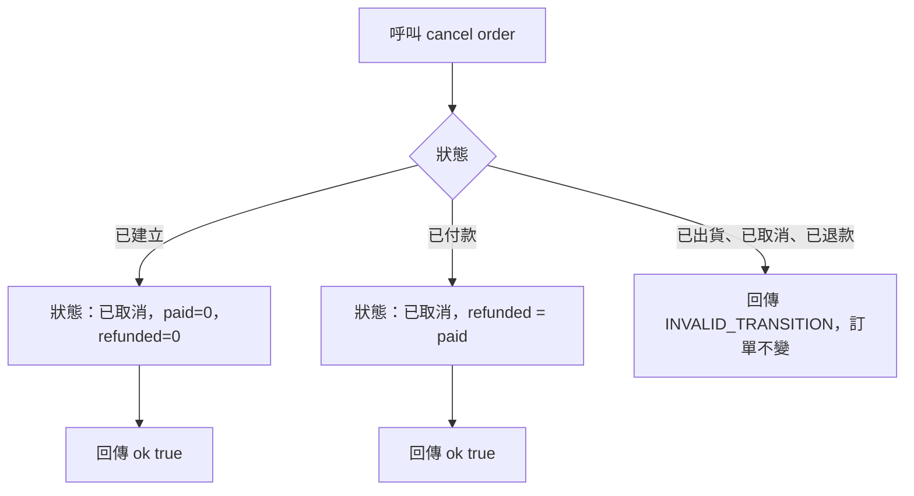

# 取消

- Rule：R-ORDER_STATE_MACHINE-006、007、010（非法狀態部分）
- 確認時間：2026-10-31 23:32

白話複述：
1. 已建立取消後為已取消，無退款（R-ORDER_STATE_MACHINE-006）。
2. 已付款取消後為已取消，退還全部已付金額，refundedAmount = paidAmount（R-ORDER_STATE_MACHINE-007）。
3. 已出貨、已取消、已退款的訂單不可取消，回傳 INVALID_TRANSITION（R-ORDER_STATE_MACHINE-010）。

已知取捨：實際金流退款不在本模組（X-ORDER_STATE_MACHINE-001）。
