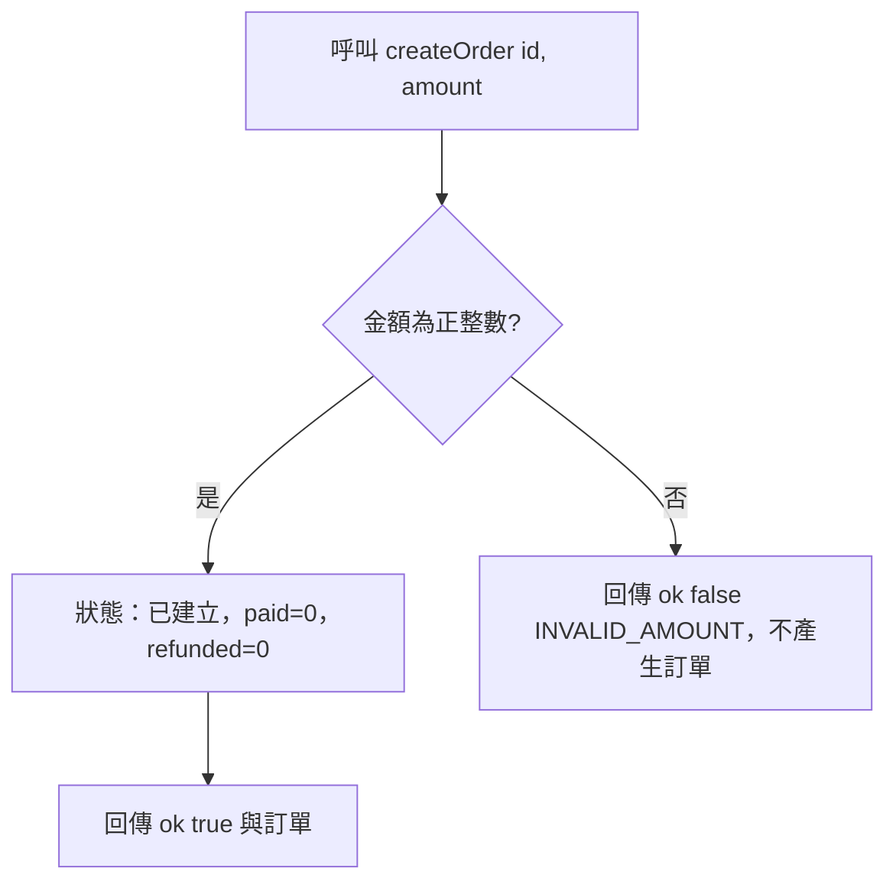

# 建立訂單

- Rule：R-ORDER_STATE_MACHINE-001、R-ORDER_STATE_MACHINE-002（主流程 R-ORDER_STATE_MACHINE-000 的第一步）
- 確認時間：2026-10-31 23:32

白話複述：
1. 金額為正整數時建立已建立訂單，已付與已退款皆為 0（R-ORDER_STATE_MACHINE-001）。
2. 金額不合法時回傳 INVALID_AMOUNT，不產生訂單（R-ORDER_STATE_MACHINE-002）。

已知取捨：不檢查訂單編號格式與唯一性，由呼叫方負責（X-ORDER_STATE_MACHINE-002）。
