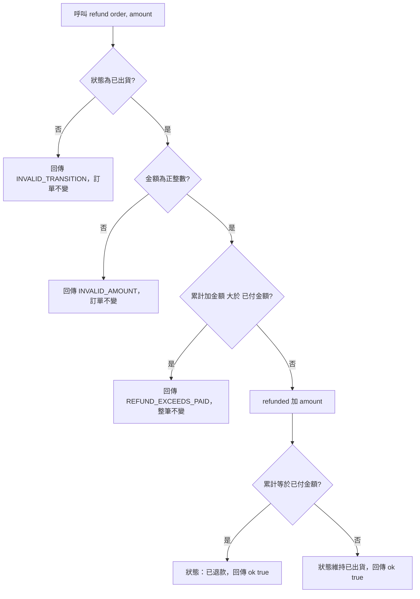

# 退款

- Rule：R-ORDER_STATE_MACHINE-008、009、010（非法狀態部分）、011（退款金額部分）、012
- 確認時間：2026-10-31 23:32

白話複述：
1. 只有已出貨的訂單可以退款；累計未超過已付金額為部分退款，狀態維持已出貨（R-ORDER_STATE_MACHINE-008）。
2. 累計剛好等於已付金額時為已退款（R-ORDER_STATE_MACHINE-009）。
3. 超過已付金額時整筆拒絕，回傳 REFUND_EXCEEDS_PAID（R-ORDER_STATE_MACHINE-012）。
4. 退款金額非正整數回傳 INVALID_AMOUNT（R-ORDER_STATE_MACHINE-011）；非已出貨回傳 INVALID_TRANSITION（R-ORDER_STATE_MACHINE-010）。

已知取捨：實際金流退款不在本模組（X-ORDER_STATE_MACHINE-001）。
