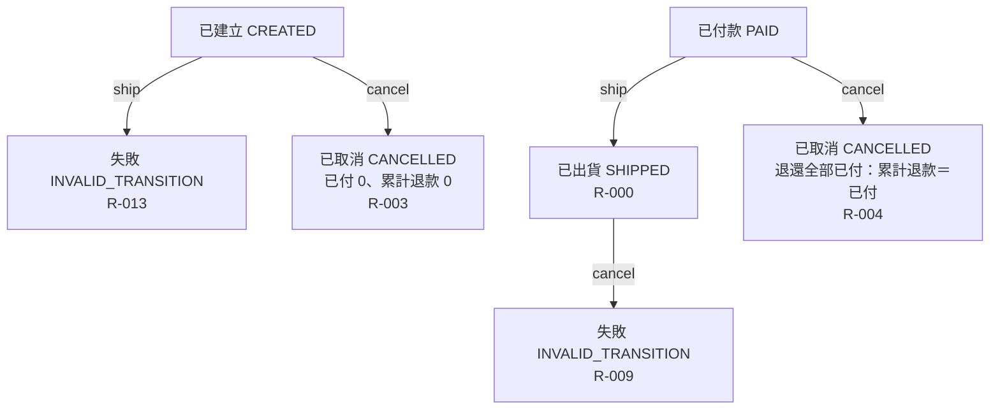

# 流程階段：出貨與取消

摘要：已付款的訂單可出貨；已建立或已付款的訂單可取消；已出貨不可取消。

rule_id：R-ORDER_STATE_MACHINE-000（沿用：PAID → ship → SHIPPED）、R-ORDER_STATE_MACHINE-003、R-ORDER_STATE_MACHINE-004、R-ORDER_STATE_MACHINE-009、R-ORDER_STATE_MACHINE-013

白話複述：
1. 已建立的訂單不能出貨，回 INVALID_TRANSITION（R-013）。
2. 已建立的訂單取消後為已取消，已付 0、累計退款 0（R-003）。
3. 已付款的訂單出貨後為已出貨（R-000）。
4. 已付款的訂單取消後為已取消，並退還全部已付金額（累計退款＝已付，已付維持）（R-004）。
5. 已出貨的訂單不能取消，回 INVALID_TRANSITION（R-009）。

已知取捨：
- 無本階段專屬條目。

確認時間：2026-10-20 07:34（使用者裁示「你決定」，由執行者代為確認無缺口）
