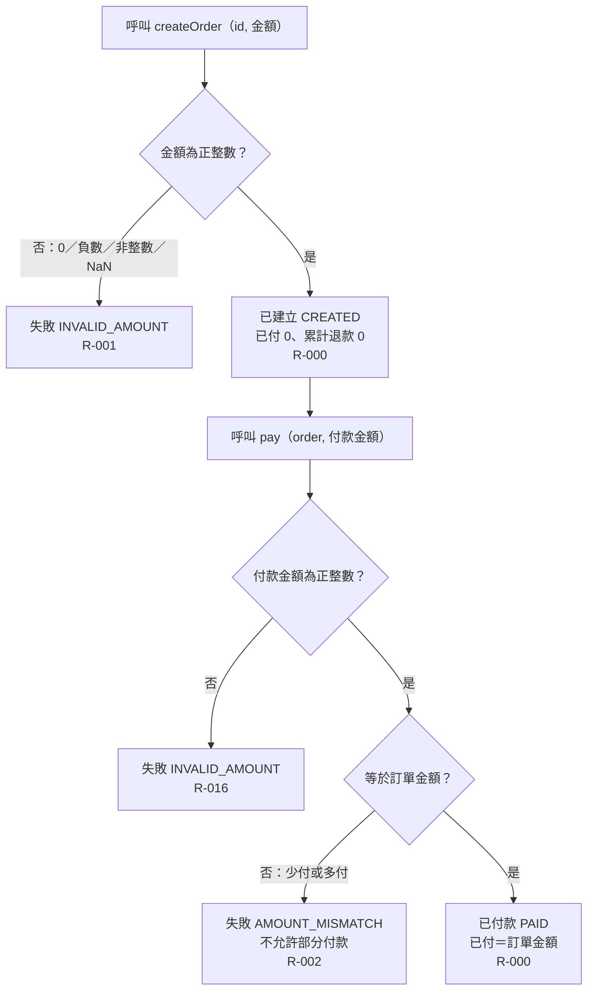

# 流程階段：建立與付款

摘要：操作者建立訂單並付入等於訂單金額的款項；金額合法性先於金額比對。

rule_id：R-ORDER_STATE_MACHINE-000、R-ORDER_STATE_MACHINE-001、R-ORDER_STATE_MACHINE-002、R-ORDER_STATE_MACHINE-016（R-ORDER_STATE_MACHINE-008 沿用：成功時回傳新物件、不改傳入 order）

白話複述：
1. 建立訂單金額必須是正整數，否則回 INVALID_AMOUNT（R-001）。
2. 合法建立後狀態為已建立，已付金額與累計退款金額皆為 0（R-000）。
3. 付款金額先驗合法性（非正整數 → INVALID_AMOUNT，R-016），再比對是否等於訂單金額（不等 → AMOUNT_MISMATCH，不允許部分付款，R-002）。
4. 等額付款後狀態為已付款，已付金額等於訂單金額（R-000）。
5. 每步皆回傳新的 order 物件，傳入物件不變（R-008）。

已知取捨：
- createOrder 不驗證 id（X-ORDER_STATE_MACHINE-001）。

確認時間：2026-10-20 07:34（使用者裁示「你決定」，由執行者代為確認無缺口）
