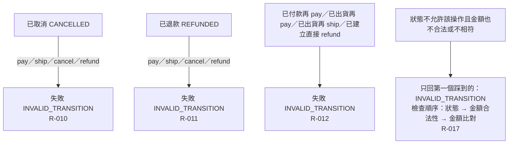

# 流程階段：終態與非法轉移防禦

摘要：已取消與已退款為終態；所有需求未允許的狀態×操作組合一律回 INVALID_TRANSITION；狀態檢查優先於金額檢查。

rule_id：R-ORDER_STATE_MACHINE-010、R-ORDER_STATE_MACHINE-011、R-ORDER_STATE_MACHINE-012、R-ORDER_STATE_MACHINE-017（R-ORDER_STATE_MACHINE-009、013、014 沿用）

狀態×操作全覽（5 狀態 × 4 操作）：
| 狀態 \ 操作 | pay | ship | cancel | refund |
| :--- | :--- | :--- | :--- | :--- |
| CREATED | R-000／002／016 | R-013 ✗ | R-003 | R-012 ✗ |
| PAID | R-012 ✗ | R-000 | R-004 | R-014 ✗ |
| SHIPPED | R-012 ✗ | R-012 ✗ | R-009 ✗ | R-005／006／007／015 |
| CANCELLED | R-010 ✗ | R-010 ✗ | R-010 ✗ | R-010 ✗ |
| REFUNDED | R-011 ✗ | R-011 ✗ | R-011 ✗ | R-011 ✗ |

白話複述：
1. 已取消後任何操作都拒絕（R-010）。
2. 已退款後任何操作都拒絕（R-011）。
3. 已付款再付款、已出貨再付款、已出貨再出貨、已建立直接退款都拒絕（R-012）。
4. 狀態錯誤與金額錯誤同時發生時只回 INVALID_TRANSITION（R-017）。

已知取捨：
- 傳入的 order 欄位自相矛盾時系統不驗證（使用者裁示非缺口，見索引）。

確認時間：2026-10-20 07:34（使用者裁示「你決定」，由執行者代為確認無缺口）
