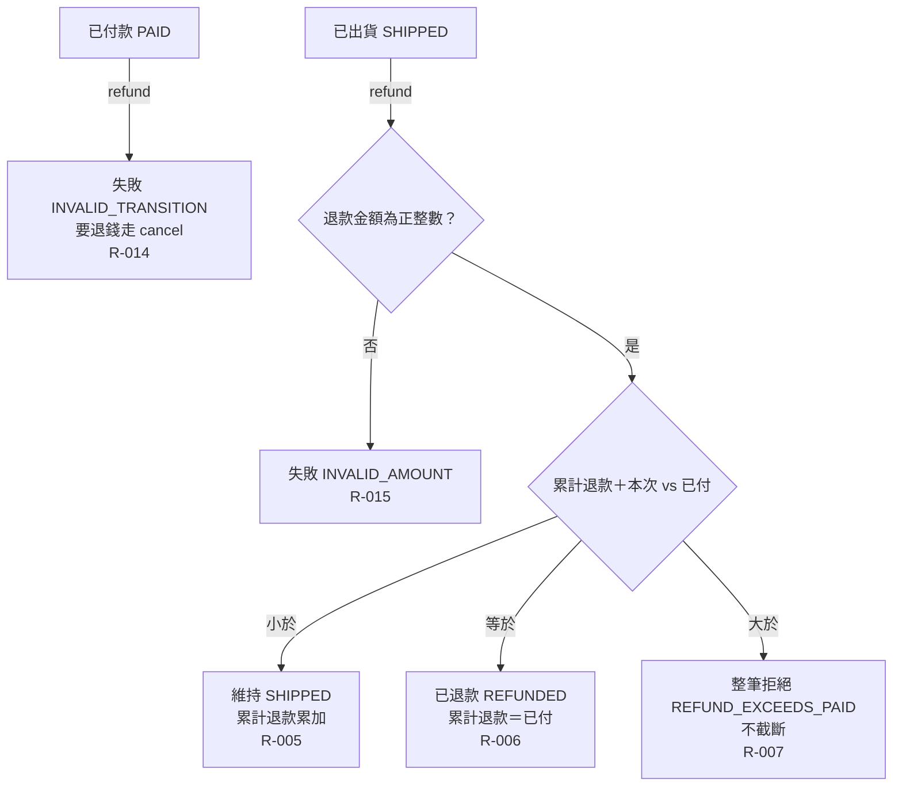

# 流程階段：退款

摘要：只有已出貨的訂單可以退款，可分多次；累計達到已付金額即為已退款，超過則整筆拒絕。

rule_id：R-ORDER_STATE_MACHINE-005、R-ORDER_STATE_MACHINE-006、R-ORDER_STATE_MACHINE-007、R-ORDER_STATE_MACHINE-014、R-ORDER_STATE_MACHINE-015

白話複述：
1. 已付款未出貨的訂單不能直接退款，回 INVALID_TRANSITION（R-014）。
2. 退款金額非正整數 → INVALID_AMOUNT（R-015）。
3. 累計加本次小於已付 → 維持已出貨、累計累加（R-005）。
4. 累計加本次恰等於已付（單次或多次）→ 已退款（R-006）。
5. 累計加本次大於已付 → 整筆拒絕 REFUND_EXCEEDS_PAID，不截斷（R-007）。

已知取捨：
- 無本階段專屬條目。

確認時間：2026-10-20 07:34（使用者裁示「你決定」，由執行者代為確認無缺口）
