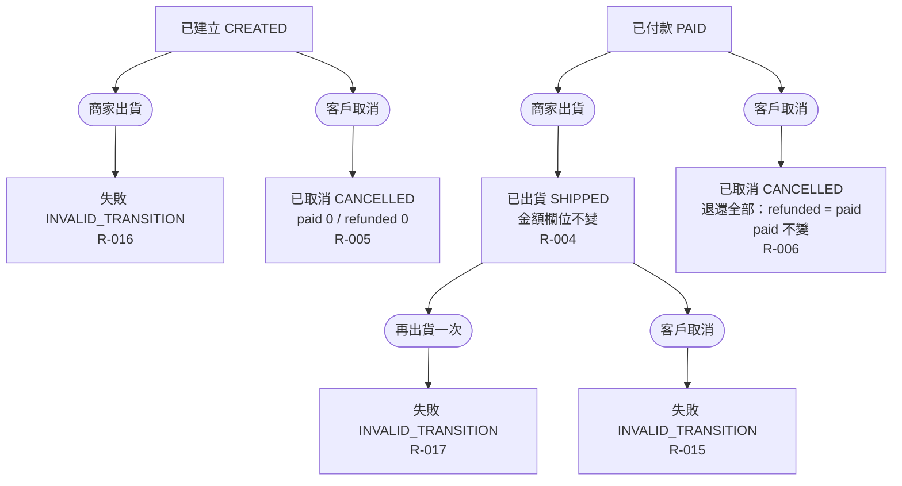

# 出貨與取消

已付款訂單出貨；已建立與已付款訂單取消；含已建立出貨、已出貨取消、重複出貨的失敗分支。

- rule_id：R-ORDER_STATE_MACHINE-004, 005, 006, 015, 016, 017

白話複述：
1. 已付款出貨 → 已出貨，金額欄位不變（R-004）；已建立出貨 → INVALID_TRANSITION（R-016）；已出貨再出貨 → INVALID_TRANSITION（R-017）
2. 已建立取消 → 已取消、兩金額 0（R-005）；已付款取消 → 已取消、refunded = paid、paid 不變（R-006）；已出貨取消 → INVALID_TRANSITION（R-015）

已知取捨：無
確認時間：2026-10-20 07:36（第 1 次 07:33 已確認；第 2 次無變更）
