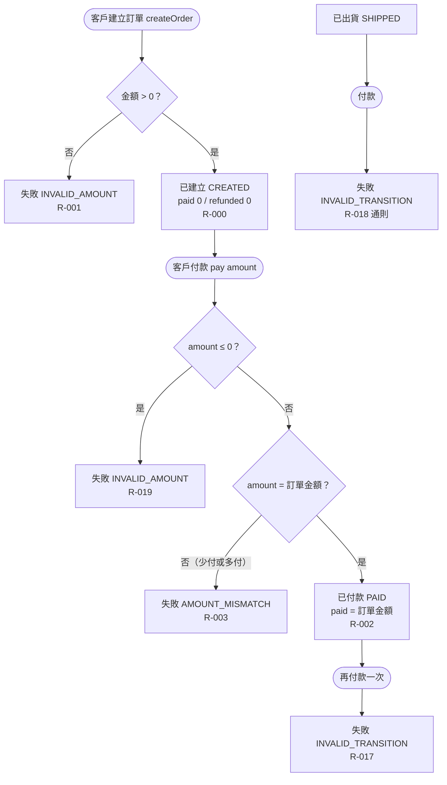

# 建立與付款

客戶建立訂單並付款，直到訂單進入已付款；含金額不合法、金額不符與重複付款的失敗分支。

- rule_id：R-ORDER_STATE_MACHINE-000, 001, 002, 003, 010, 017, 018, 019

白話複述：
1. 金額 > 0 建立 → 已建立、已付 0、已退 0（R-000）；金額 ≤ 0 → INVALID_AMOUNT（R-001）
2. 已建立付款：金額 ≤ 0 → INVALID_AMOUNT（R-019）；金額 > 0 但不等 → AMOUNT_MISMATCH（R-003）；相等 → 已付款（R-002）
3. 已付款再付款 → INVALID_TRANSITION（R-017）；已出貨付款 → INVALID_TRANSITION（R-018）
4. 狀態不允許且金額也錯時只回 INVALID_TRANSITION（R-010，沿用）

已知取捨：無
確認時間：2026-10-20 07:36（第 1 次 07:33 已確認主幹；第 2 次新增 R-018、R-019 節點後確認）
