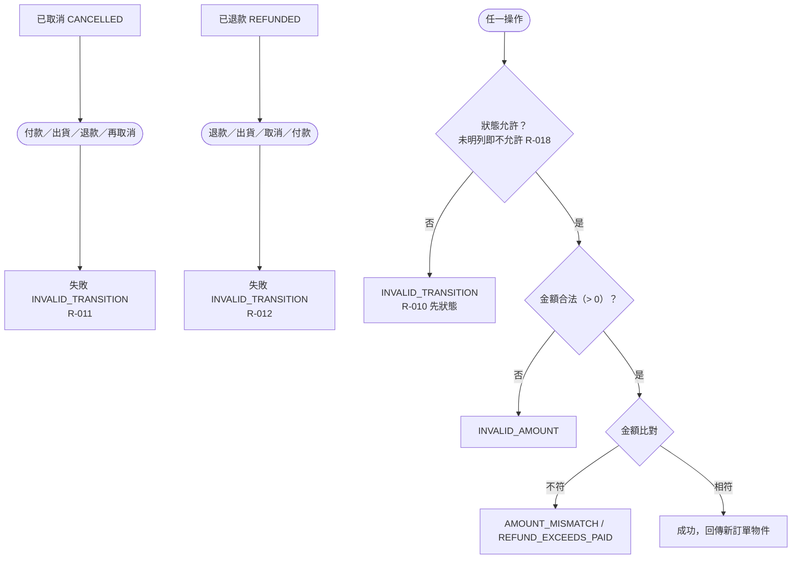

# 終態與多重錯誤優先序

已取消、已退款為終態，任何操作一律拒絕；所有操作的檢查順序固定為先狀態、再金額合法性、再金額比對；未明列的狀態×操作組合視為狀態不允許。

- rule_id：R-ORDER_STATE_MACHINE-010, 011, 012, 018

白話複述：
1. 已取消後任何操作 → INVALID_TRANSITION（R-011）；已退款後任何操作 → INVALID_TRANSITION（R-012）
2. 狀態不允許且金額同時有錯，只回 INVALID_TRANSITION（R-010）
3. 凡矩陣未明列為允許的狀態×操作 → INVALID_TRANSITION（R-018）
4. 所有操作皆為純函式，不修改傳入訂單

已知取捨：無
確認時間：2026-10-20 07:36（第 1 次 07:33 已確認；第 2 次新增 R-018 通則節點後確認）
