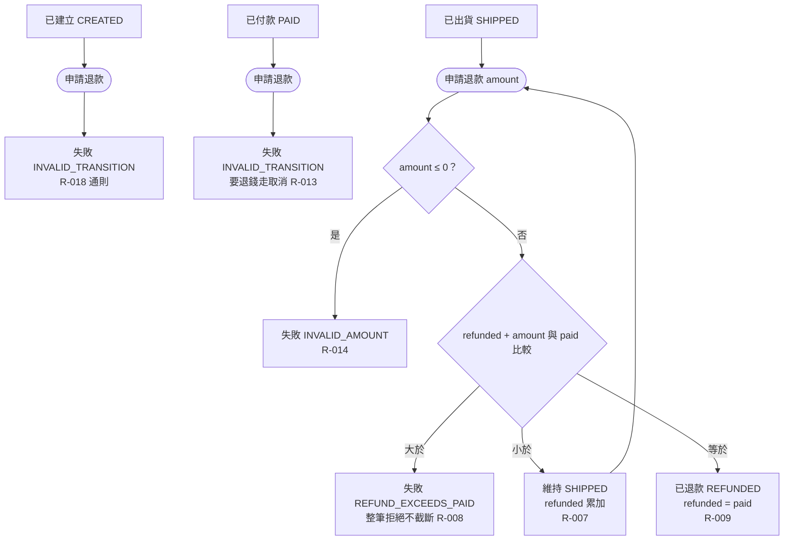

# 退款

已出貨訂單可分多次退款；含金額不合法、超過上限、未達／剛好達到已付金額，以及已付款、已建立訂單退款的失敗分支。

- rule_id：R-ORDER_STATE_MACHINE-007, 008, 009, 013, 014, 018

白話複述：
1. 已出貨退款金額 ≤ 0 → INVALID_AMOUNT（R-014）
2. 累計 + 本次 > 已付 → REFUND_EXCEEDS_PAID，整筆拒絕不截斷（R-008）
3. 累計 + 本次 < 已付 → 維持已出貨、累計累加，可再退（R-007）
4. 累計 + 本次 = 已付（可多次累計達到）→ 已退款（R-009）
5. 已付款直接退款 → INVALID_TRANSITION（R-013）；已建立退款 → INVALID_TRANSITION（R-018）

已知取捨：無
確認時間：2026-10-20 07:36（第 1 次 07:33 已確認；第 2 次新增 R-018 節點後確認）
