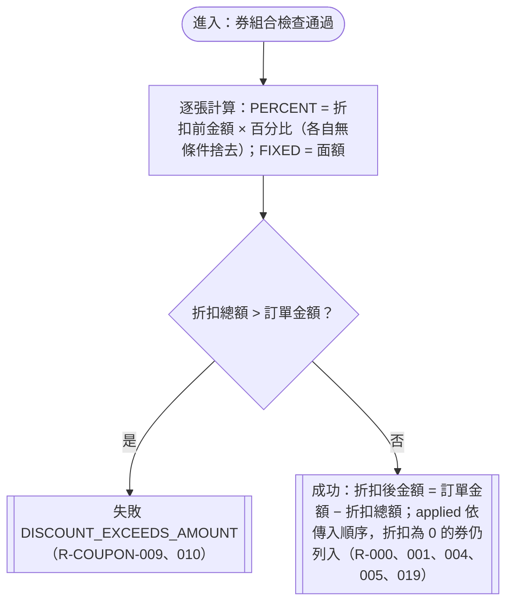

# 折扣計算

確認時間：2026-10-31 23:33
rule_id：R-COUPON-000、001、004、005、009、010、019

白話複述：
1. 百分比以折扣前金額計算，每張各自無條件捨去（R-000、004）
2. 固定金額直接折抵面額（R-001）
3. 百分比與固定金額可同時使用，百分比仍以折扣前金額計算（R-005）
4. 折扣總額超過訂單金額，整筆拒絕 DISCOUNT_EXCEEDS_AMOUNT；剛好等於可以，折後金額 0（R-009、010）
5. 百分比折扣為 0 元，券仍列入 applied（R-019，spec 判斷）

已知取捨：無
