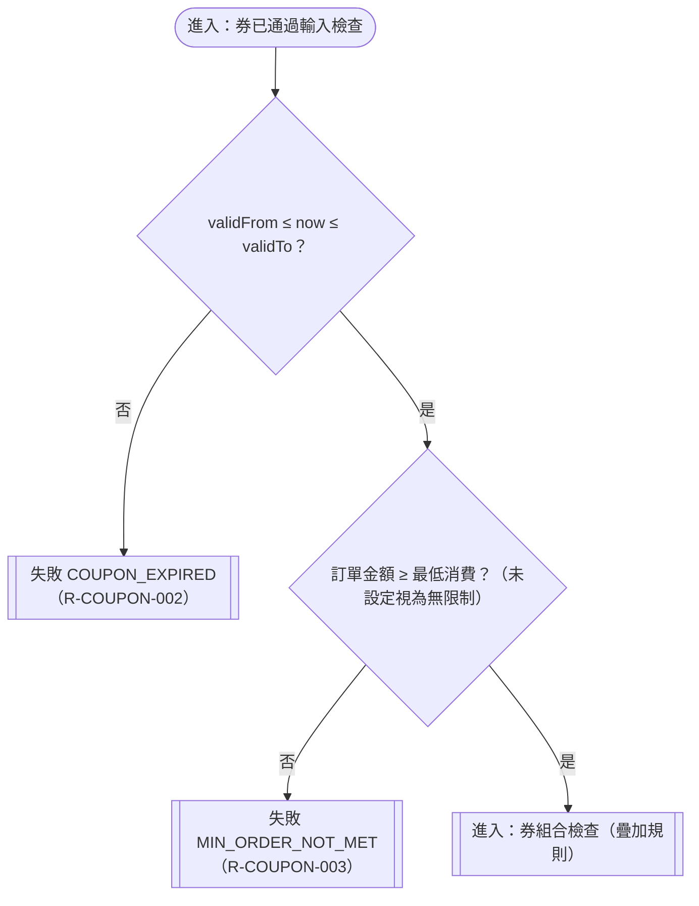

# 有效期間與最低消費

確認時間：2026-10-31 23:33
rule_id：R-COUPON-002、003、018

白話複述：
1. 現在時間不在有效期間內（含未生效與已過期），整筆拒絕 COUPON_EXPIRED（R-002）；期間含起迄
2. 訂單金額低於最低消費，整筆拒絕 MIN_ORDER_NOT_MET（R-003）
3. 訂單金額等於最低消費可用（R-018）

已知取捨：無
