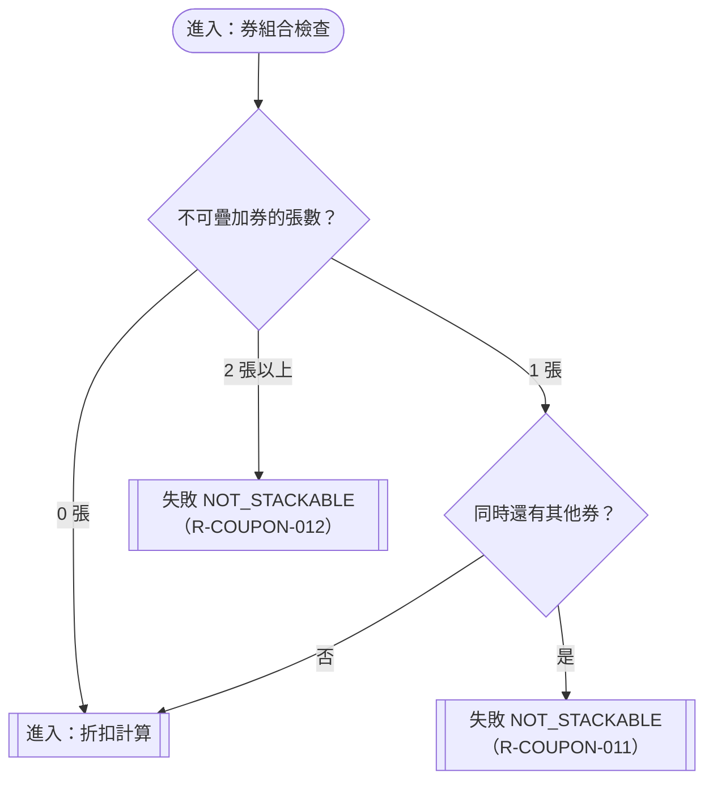

# 疊加規則

確認時間：2026-10-31 23:33（第 1 次確認，第 2 次沿用）
rule_id：R-COUPON-006、011、012

白話複述：
1. 不可疊加券只能單獨使用，單獨使用可套用（R-006）
2. 不可疊加券與其他券併用，整筆拒絕 NOT_STACKABLE（R-011）
3. 兩張以上不可疊加券同時出現，整筆拒絕 NOT_STACKABLE（R-012）

已知取捨：無
