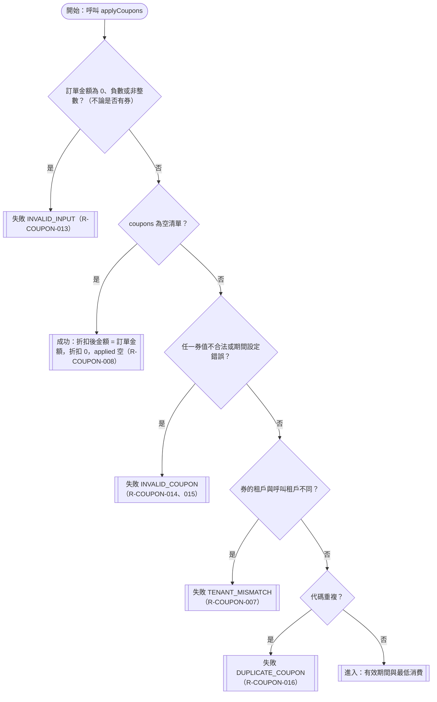

# 輸入檢查與結果判定

確認時間：2026-10-31 23:33
rule_id：R-COUPON-007、008、013、014、015、016、017

白話複述：
1. 訂單金額為 0、負數或非整數，不論有無券，整筆拒絕 INVALID_INPUT（R-013）
2. 沒傳任何券、訂單金額合法，成功，折扣 0（R-008）
3. 券值不合法或期間設定錯誤，整筆拒絕 INVALID_COUPON（R-014、015）
4. 券租戶不同，整筆拒絕 TENANT_MISMATCH（R-007）
5. 代碼重複，整筆拒絕 DUPLICATE_COUPON（R-016）
6. 多個錯誤同時命中，依 R-017 固定順序回報第一個命中

已知取捨：無
