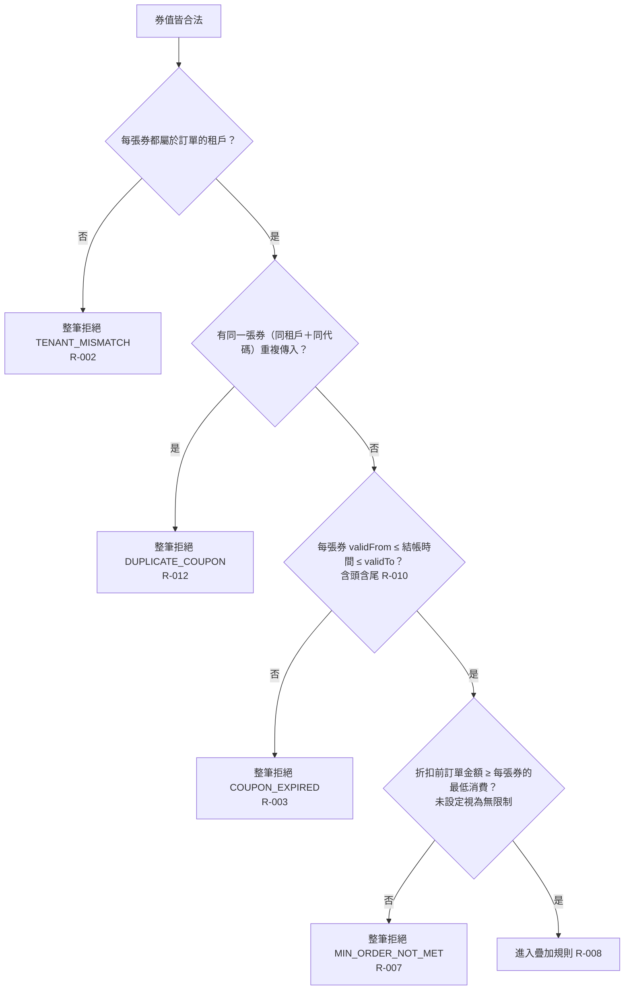

# 券資格檢查

券值合法之後，依序檢查每張券是否屬於同一租戶、是否重複傳入、是否在有效期間內、訂單是否達到最低消費。

- rule_id：R-MULTI_TENANT_COUPON-002、R-MULTI_TENANT_COUPON-003、R-MULTI_TENANT_COUPON-007、R-MULTI_TENANT_COUPON-008、R-MULTI_TENANT_COUPON-010、R-MULTI_TENANT_COUPON-012

## 白話複述
1. 有一張券屬於別的租戶 → 整筆拒絕 `TENANT_MISMATCH`（R-002）
2. 同一張券（同租戶＋同代碼）傳兩次 → 整筆拒絕 `DUPLICATE_COUPON`（R-012）
3. 有一張券過期或尚未生效 → 整筆拒絕 `COUPON_EXPIRED`（R-003）
4. 結帳時間剛好等於 validFrom 或 validTo → 仍有效（R-010）
5. 折扣前訂單金額未達某張券的最低消費 → 整筆拒絕 `MIN_ORDER_NOT_MET`（R-007）
6. 達到或剛好等於最低消費 → 可用（R-008）

## 已知取捨
- 同租戶代碼唯一的持久層約束屬其他模組（X-MULTI_TENANT_COUPON-001）

確認時間：2026-10-20 15:19
