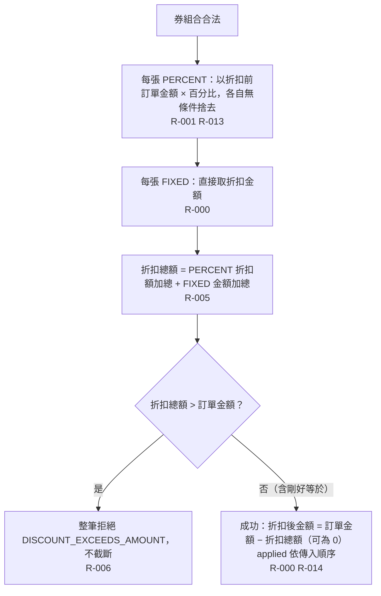

# 折扣計算與結果

券組合合法後計算折扣總額，檢查不得使訂單金額低於 0，成功時回傳折扣後金額、折扣總額與依傳入順序的套用代碼。

- rule_id：R-MULTI_TENANT_COUPON-000、R-MULTI_TENANT_COUPON-001、R-MULTI_TENANT_COUPON-005、R-MULTI_TENANT_COUPON-006、R-MULTI_TENANT_COUPON-013、R-MULTI_TENANT_COUPON-014

## 白話複述
1. 單張固定金額券 100、訂單 1000 → 折 100、剩 900（R-000）
2. 單張 10% 券、訂單 1000 → 以折扣前金額算，折 100、剩 900（R-001）
3. 多張可疊加：P10、F100、P5、訂單 1000 → 100 + 50 + 100 = 250、剩 750，applied [P10, F100, P5]（R-005）
4. 百分比算出小數各自捨去：333 元 10% + 5% → 33 + 16 = 49、剩 284（R-013）
5. 折扣總額超過訂單金額 → 整筆拒絕 `DISCOUNT_EXCEEDS_AMOUNT`（R-006）
6. 折扣總額剛好等於訂單金額 → 成功，折扣後 0（R-014）

確認時間：2026-10-20 15:19
