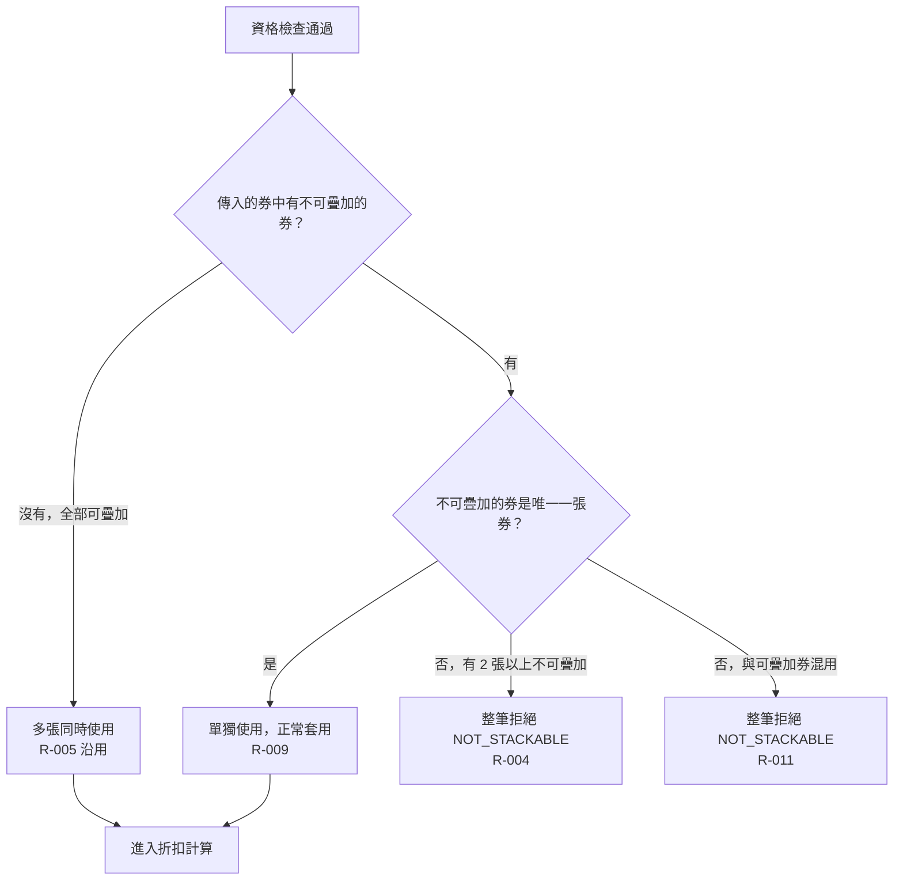

# 疊加規則

資格檢查通過後，檢查券的組合是否違反可疊加規則。

- rule_id：R-MULTI_TENANT_COUPON-004、R-MULTI_TENANT_COUPON-005（沿用）、R-MULTI_TENANT_COUPON-009、R-MULTI_TENANT_COUPON-011

## 白話複述
1. 兩張以上不可疊加券 → 整筆拒絕 `NOT_STACKABLE`（R-004）
2. 不可疊加券與可疊加券混用 → 整筆拒絕 `NOT_STACKABLE`（R-011）
3. 單張不可疊加券單獨使用 → 正常套用（R-009）
4. 全部可疊加 → 多張同時使用（R-005）

確認時間：2026-10-20 15:19
