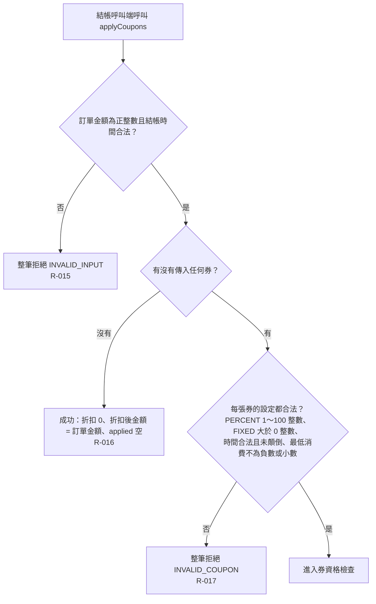

# 輸入與券值檢查

結帳一開始先檢查呼叫端傳入的訂單金額、結帳時間與每張券本身的設定是否合法；沒傳任何券則直接成功。

- rule_id：R-MULTI_TENANT_COUPON-015、R-MULTI_TENANT_COUPON-016、R-MULTI_TENANT_COUPON-017

## 白話複述
1. 訂單金額為 0、負數或非整數，或結帳時間不合法 → 整筆拒絕 `INVALID_INPUT`（R-015）
2. 沒傳任何券 → 成功，折扣 0、折扣後金額等於訂單金額、套用清單為空（R-016）
3. 有任何一張券設定不合法（百分比不在 1～100、固定金額 ≤ 0、非整數、時間不合法或期間顛倒、最低消費為負數或非整數；最低消費設 0 合法）→ 整筆拒絕 `INVALID_COUPON`（R-017）

## 已知取捨
- applyCoupons 為純函式，不讀寫資料庫（X-MULTI_TENANT_COUPON-001）

確認時間：2026-10-20 15:19
