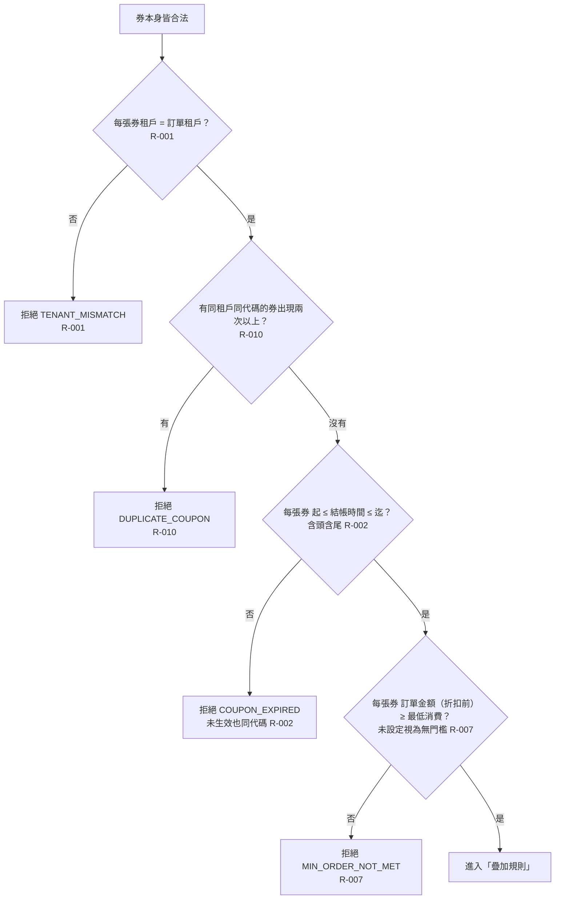

# 優惠券資格驗證

券本身合法後，逐項確認這批券能不能用在這筆訂單：租戶、重複、有效期間、最低消費。任何一項不過都整筆拒絕，不略過單張。

- rule_id：R-MULTI_TENANT_COUPON-001、002、007、010、013（沿用）

## 白話複述
1. 任一張券不屬於這筆訂單的租戶 → 整筆拒絕，原因 TENANT_MISMATCH（R-001）。
2. 同一張券（同租戶同代碼）傳了兩次以上 → 整筆拒絕，原因 DUPLICATE_COUPON（R-010）。
3. 任一張券不在有效期間（結帳時間早於起或晚於迄；剛好等於起或迄都算有效）→ 整筆拒絕，原因 COUPON_EXPIRED，未生效與已過期同一代碼（R-002）。
4. 任一張券的最低消費高於折扣前訂單金額（剛好等於可以）→ 整筆拒絕，原因 MIN_ORDER_NOT_MET（R-007）。
5. 檢查順序依 R-013（沿用）。

## 已知取捨
- X-MULTI_TENANT_COUPON-001：純函式，不存取資料庫、不持久化、不記錄使用紀錄。

## 確認時間
2026-10-20 15:17（第 1 次確認無不一致，第 2 次沿用）
