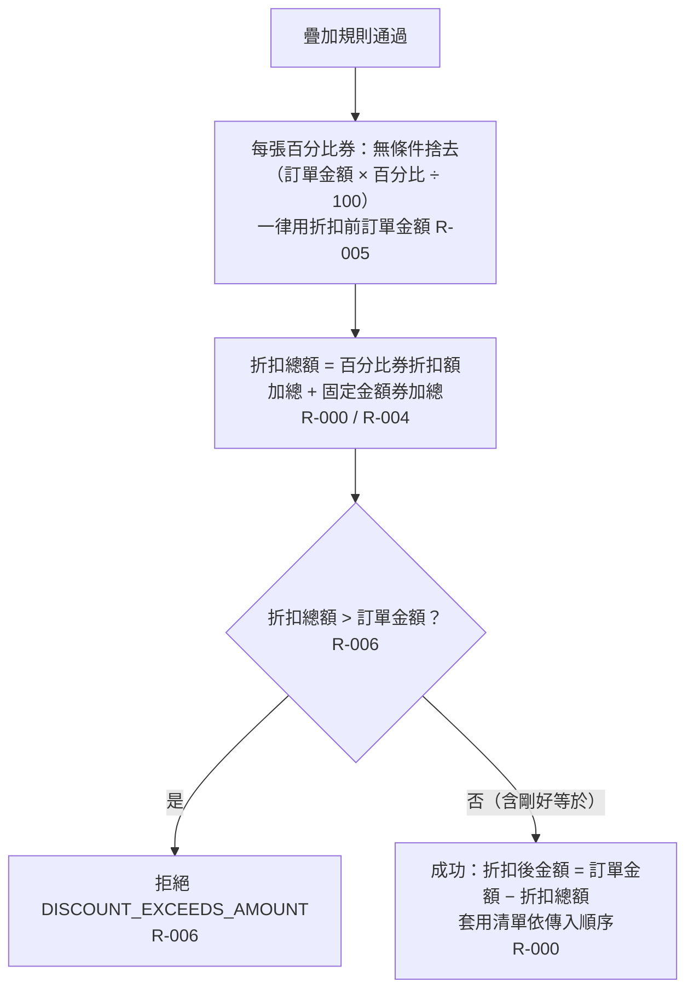

# 折扣計算與成交

算出折扣總額：每張百分比券各自用折扣前訂單金額計算並無條件捨去，加上所有固定金額券；超過訂單金額整筆拒絕，剛好等於可以。

- rule_id：R-MULTI_TENANT_COUPON-000、004（沿用）、005、006、013（沿用）

## 白話複述
1. 每張百分比券的折扣額 = 無條件捨去（折扣前訂單金額 × 百分比 ÷ 100），各自取整後才加總，不受其他券影響（R-005）。
2. 折扣總額 = 所有百分比券折扣額 + 所有固定金額券金額（R-000、R-004）。
3. 折扣總額超過訂單金額 → 整筆拒絕，原因 DISCOUNT_EXCEEDS_AMOUNT；剛好等於可以，折扣後金額為 0（R-006）。
4. 成功時回傳折扣後金額、折扣總額、依傳入順序的實際套用代碼（R-000）。

## 已知取捨
- X-MULTI_TENANT_COUPON-001：純函式，不存取資料庫、不持久化、不記錄使用紀錄。

## 確認時間
2026-10-20 15:17（第 1 次確認無不一致，第 2 次沿用）
