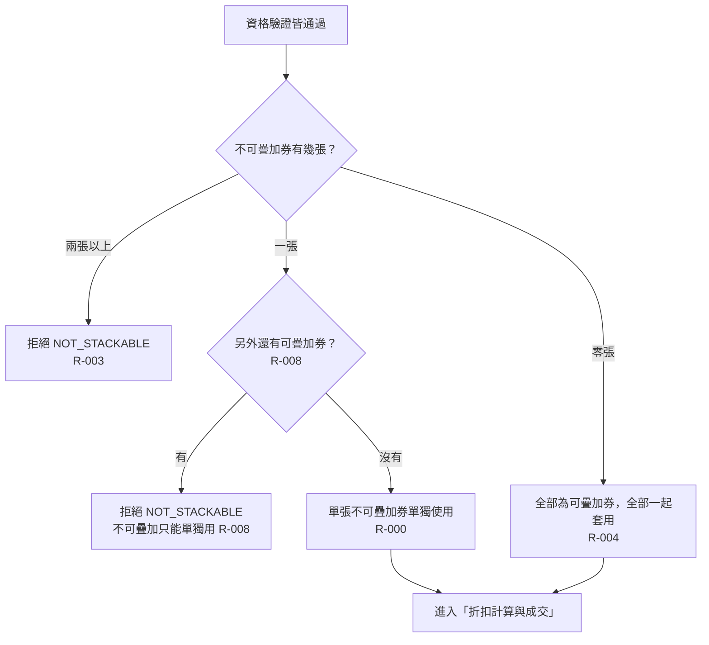

# 疊加規則

資格都過了，再看這批券能不能一起用：不可疊加的券只能單獨用一張；可疊加的券可以多張一起用。

- rule_id：R-MULTI_TENANT_COUPON-000、003、004、008、013（沿用）

## 白話複述
1. 兩張以上不可疊加的券一起傳 → 整筆拒絕，原因 NOT_STACKABLE（R-003）。
2. 一張不可疊加券加上一張以上可疊加券 → 整筆拒絕，原因 NOT_STACKABLE（R-008）。
3. 只有一張不可疊加券 → 可以單獨使用（R-000）。
4. 全部都是可疊加券 → 全部一起套用（R-004）。
5. 檢查順序依 R-013（沿用）。

## 已知取捨
- X-MULTI_TENANT_COUPON-001：純函式，不存取資料庫、不持久化、不記錄使用紀錄。

## 確認時間
2026-10-20 15:17（第 1 次確認無不一致，第 2 次沿用）
