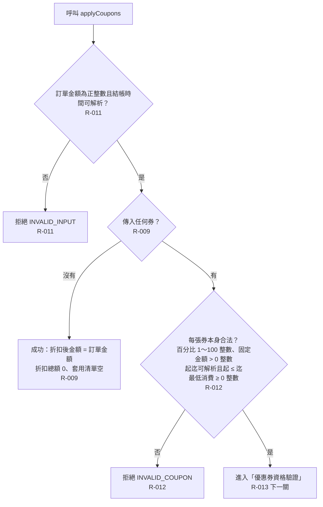

# 輸入合法性檢查

結帳一開始先檢查訂單輸入與每張券本身的資料是否合法；空券清單直接成功。檢查順序依 R-013。

- rule_id：R-MULTI_TENANT_COUPON-009、011、012、013

## 白話複述
1. 訂單金額為 0、負數或非整數，或結帳時間解析不了 → 拒絕，原因 INVALID_INPUT（R-011）。
2. 沒傳任何券 → 成功，折扣後金額等於訂單金額、折扣總額 0、套用清單空（R-009）。
3. 任一張券本身不合法（百分比不是 1～100 整數、固定金額不是正整數、起迄解析不了或起晚於迄、最低消費為負數或非整數）→ 拒絕，原因 INVALID_COUPON（R-012）。
4. 多個錯誤同時發生時依固定順序回報第一個：INVALID_INPUT → INVALID_COUPON → TENANT_MISMATCH → DUPLICATE_COUPON → COUPON_EXPIRED → MIN_ORDER_NOT_MET → NOT_STACKABLE → DISCOUNT_EXCEEDS_AMOUNT（R-013）。

## 已知取捨
- X-MULTI_TENANT_COUPON-001：純函式，不存取資料庫、不持久化、不記錄使用紀錄。

## 確認時間
2026-10-20 15:19（第 2 次流程對齊，R-012 修改後重畫）
