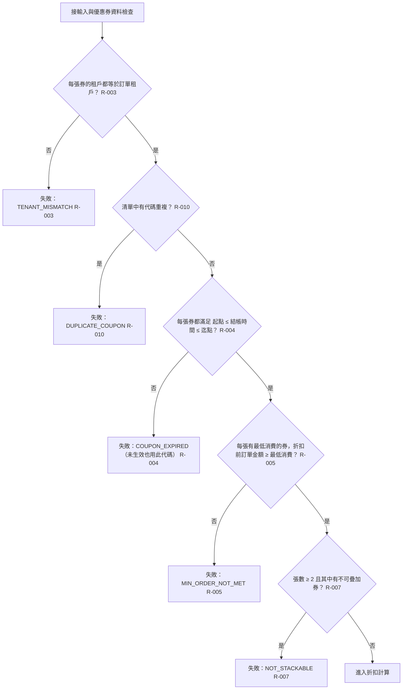

# 優惠券可用性與疊加檢查

摘要：資料合法後，依序檢查租戶、代碼重複、有效期間、最低消費與疊加規則；任一類不通過即整筆失敗，一張都不套用。

- rule_id：R-TENANT_COUPON-003、R-TENANT_COUPON-010、R-TENANT_COUPON-004、R-TENANT_COUPON-005、R-TENANT_COUPON-007、R-TENANT_COUPON-013（沿用）

## 白話複述
1. 任一張券租戶與訂單租戶不同 → 整筆失敗 TENANT_MISMATCH（R-TENANT_COUPON-003）
2. 清單中代碼重複 → 整筆失敗 DUPLICATE_COUPON（R-TENANT_COUPON-010）
3. 任一張券結帳時間早於起點或晚於迄點 → 整筆失敗 COUPON_EXPIRED；等於起點或迄點算有效（R-TENANT_COUPON-004）
4. 任一張券有最低消費且折扣前訂單金額小於它 → 整筆失敗 MIN_ORDER_NOT_MET；等於可以；未設定無限制（R-TENANT_COUPON-005）
5. 兩張以上且其中有不可疊加券 → 整筆失敗 NOT_STACKABLE；不可疊加券單獨使用照常（R-TENANT_COUPON-007）
6. 多重問題依固定順序回報第一個命中的；例：第一張過期、第二張租戶不符 → TENANT_MISMATCH（R-TENANT_COUPON-013）

## 已知取捨
- 本模組不讀寫資料庫，代碼唯一性的落庫檢查不在本模組（X-TENANT_COUPON-001）

確認時間：2026-10-20 15:38
