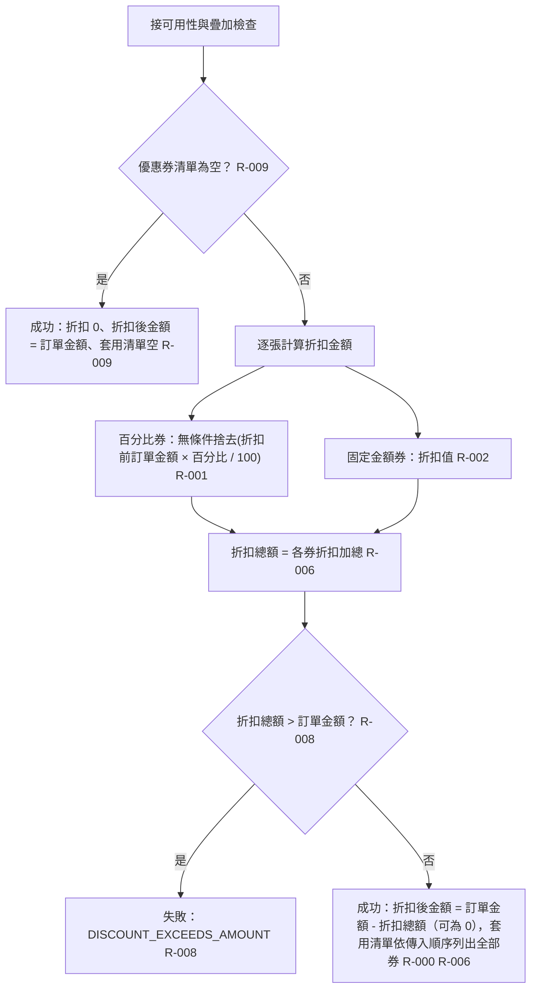

# 折扣計算與結帳結果

摘要：通過所有檢查後計算各券折扣並加總；折扣總額超過訂單金額則失敗，否則回傳成功結果。

- rule_id：R-TENANT_COUPON-009、R-TENANT_COUPON-000、R-TENANT_COUPON-001、R-TENANT_COUPON-002、R-TENANT_COUPON-006、R-TENANT_COUPON-008

## 白話複述
1. 沒傳任何券 → 成功，折扣 0、折扣後金額 = 訂單金額、套用清單空（R-TENANT_COUPON-009）
2. 單張可用券 → 成功，回傳折扣、折扣後金額與該券代碼（R-TENANT_COUPON-000）
3. 百分比券折扣 = 折扣前訂單金額 × 百分比 ÷ 100，各自無條件捨去（R-TENANT_COUPON-001）
4. 固定金額券折扣 = 券面金額（R-TENANT_COUPON-002）
5. 多張可疊加券 → 折扣加總，套用清單依傳入順序（R-TENANT_COUPON-006）
6. 折扣總額大於訂單金額 → 整筆失敗 DISCOUNT_EXCEEDS_AMOUNT；剛好等於可以，折扣後金額 0（R-TENANT_COUPON-008）

## 已知取捨
- 百分比券捨去後折扣為 0 元時照常成功並列入套用清單（使用者授權裁示，2026-10-20）

確認時間：2026-10-20 15:38
