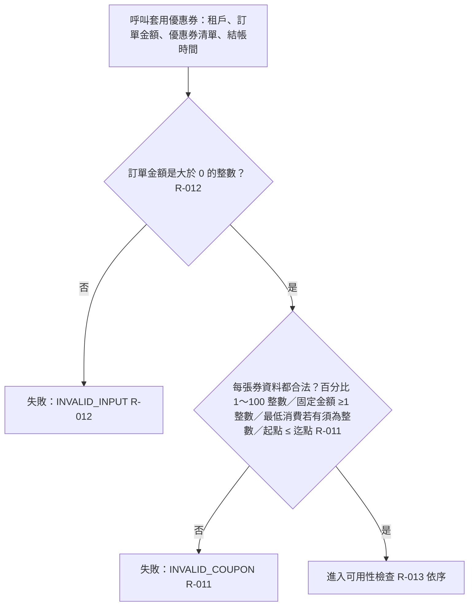

# 輸入與優惠券資料檢查

摘要：套用優惠券前，先檢查訂單金額與每張優惠券資料本身是否合法；不合法即整筆失敗。

- rule_id：R-TENANT_COUPON-012、R-TENANT_COUPON-011、R-TENANT_COUPON-013

## 白話複述
1. 訂單金額為 0、負數或非整數 → 整筆失敗 INVALID_INPUT（R-TENANT_COUPON-012）
2. 任一張券資料不合法（百分比不是 1～100 整數、固定金額不是 ≥1 整數、最低消費有值但不是整數、起點晚於迄點）→ 整筆失敗 INVALID_COUPON；起點等於迄點算合法（R-TENANT_COUPON-011）
3. 同時命中多個問題 → 依固定檢查順序回報第一個命中的，每類檢查掃過全部券（R-TENANT_COUPON-013）

## 已知取捨
- 日期字串格式正確性由呼叫端保證，本模組不檢查（X-TENANT_COUPON-002）
- 最低消費為 0 或負數視為合法（永遠達標），不屬 INVALID_COUPON（使用者授權裁示，2026-10-20）

確認時間：2026-10-20 15:38
