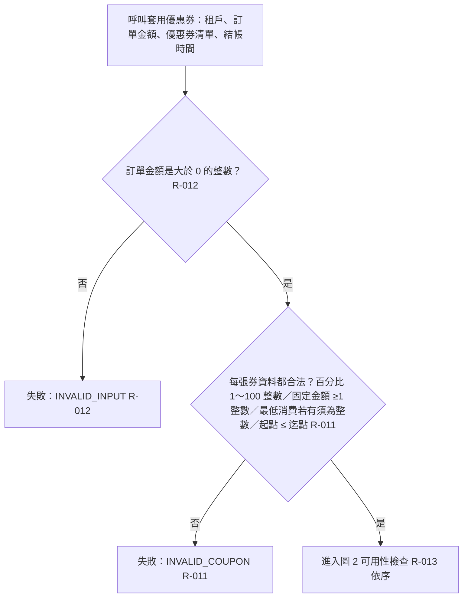
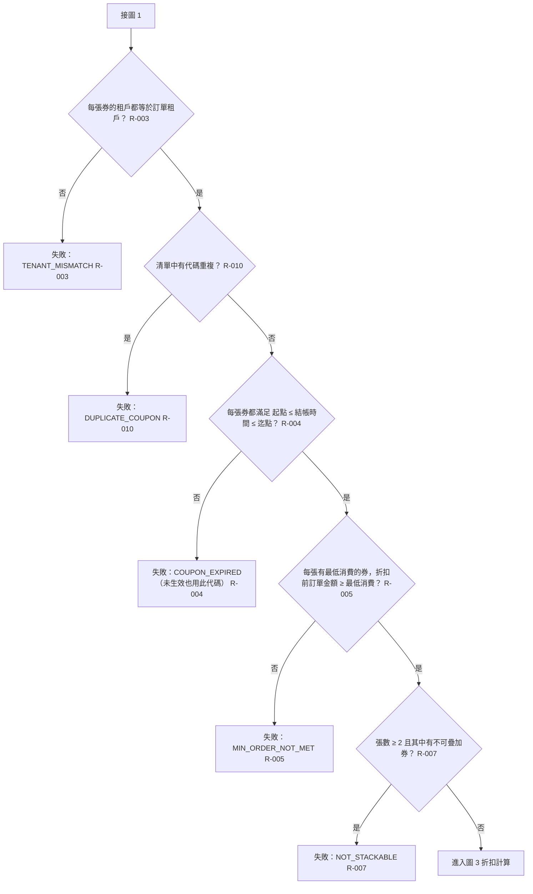
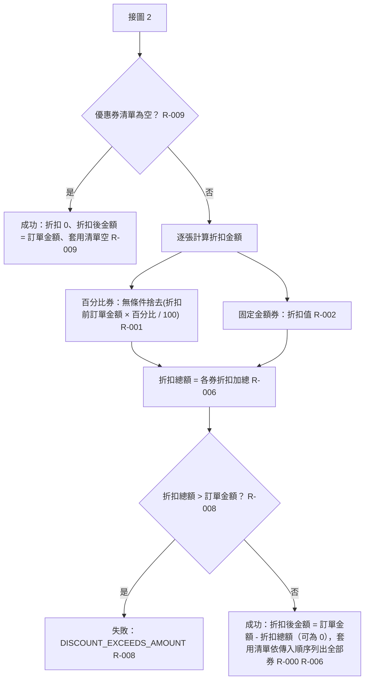

# BENCH-LOG：T3-C-r3

## 時間紀錄
- 開始：2026-10-20 15:29:20

## (a) spec-manifest-sync（首次導入）
- 模式：manifest 首次建立 ｜ CLAUDE.md 區塊首次插入（v2.0.0，CLAUDE.md 原不存在 → 新建；無既有 `.claude/skills/` 工具，EXISTING_TOOLS_NOTE 行移除）
- 必填欄位全部有直接證據或使用者事先提供（Binding Layer = direct、Driver Directory 不適用），Step 3 無需提問。
- 變更明細（相對範本）：
  - 1「Source Root Directory」：〔待確認〕→ `src/`（直接證據：README、tsconfig include）
  - 1「Test Root Directory」：〔待確認〕→ `tests/`（直接證據：tsconfig、cucumber.cjs）
  - 1「Step Definitions Directory」：〔待確認〕→ `tests/steps/`（直接證據：cucumber.cjs import、README）
  - 2「Primary Language & Runtime」：〔待確認〕→ TypeScript 5.x + Node ESM（直接證據）；Node v24.18.0（本機實測）
  - 5「BDD Execution Framework」：〔待確認〕→ `@cucumber/cucumber` 11.3.0（直接證據）
  - 5「Assertion Library」：〔待確認〕→ `node:assert/strict`（唯一候選）
  - 5「Test Execution Command」：〔待確認〕→ `npm test`（直接證據）
  - 5「Test Report Path」：〔待確認〕→ `reports/cucumber.json`（直接證據：cucumber.cjs format）
  - 5「Binding Layer」：〔待確認〕→ `direct`（使用者提供）
  - 5「Driver Directory」：〔待確認〕→ 不適用（使用者提供）
- 仍待確認：Architecture Pattern、DB/ORM/Migration/Seed、UI/CSS、第 3 節命名慣例（樣本不足）、Test Identifier Language（團隊決策，spec 04 預設 en）、第 4 節、PBT 套件、Seeding/Isolation/Test Double、Schema Introspection、第 6 節。
- 未修改兩個目標以外的任何檔案。

## (b) spec-run
- Step 00：spec-status.js --json → exit 2（找不到 matrix/），起點 = spec-01。

### spec-01 完成彙報
```text
[Phase 01: Discovery Bootstrap] 執行完成！模組：TENANT_COUPON

矩陣：9 條 Rules ｜ erm.dbml：3 個 Tables ｜ terms.md：16 個術語 ｜ exclusions：1 條 ｜ 套用慣例：0 項
待答：12 題（High 5 ｜ Medium 7 ｜ Low 0）
階段：CLARIFYING
```
- feature-lint：PASS（exit 0，0 個句型）
- spec-status：stage CLARIFYING, next spec 02, pending 12, warnings []

### spec-02 第 1 輪提問（2026-10-20 15:34:05，一次列出全部 5 組 12 題）
```text
====================================================================
❓ [模組：TENANT_COUPON] [第 1～4 / 共 12 題] [定位：套用失敗處理（R-003／004／005、失敗原因）]
--------------------------------------------------------------------
Q1（High）一次傳入多張券，其中某張不能用（租戶不同／不在有效期間／未達最低消費）時，整筆結帳怎麼回應？
  影響：成功或失敗的判定、套用清單內容、所有混合情境測試
  [A] 整筆失敗：任一張不能用就回傳失敗與原因，所有券都不套用
  [B] 略過不能用的券：其餘照常套用並回傳成功，不回報原因（全部不能用時也回成功、折扣 0）
  [C] 略過不能用的券，但若一張都沒套用成功，回傳失敗與第一張不能用券的原因
  [Short] 自訂（<=5 字）
Q2（High）失敗原因要用什麼固定文字？
  影響：所有失敗情境的期望原因、產品代碼的原因字串
  [A] 英文代碼：租戶不符 TENANT_MISMATCH、尚未生效 COUPON_NOT_STARTED、已過期 COUPON_EXPIRED、未達最低消費 MIN_ORDER_NOT_MET、不可疊加衝突 NOT_STACKABLE（其他情境同風格新增）
  [B] 中文文字：「優惠券不屬於此租戶」「優惠券尚未生效」「優惠券已過期」「未達最低消費金額」「此優惠券不可與其他優惠券併用」（其他情境同風格新增）
  [C] 英文代碼，但「尚未生效」與「已過期」合併為 COUPON_NOT_IN_PERIOD
  [Short] 自訂（<=5 字），或直接提供整組文案
Q3（Medium）同時有好幾個問題（例如第一張過期、第二張租戶不符；或同一張既過期又未達最低消費）時，回報哪一個原因？
  影響：檢查順序、多重問題情境的期望原因
  [A] 依傳入順序逐張檢查，回報第一張有問題的券；同一張依「租戶 → 有效期間 → 最低消費」回報第一個不符項
  [B] 先依類別再依順序：先查所有券的租戶，再查有效期間，再查最低消費，回報最先遇到的
  [C] 回報全部問題，串成一個字串
  [Short] 自訂（<=5 字）
Q4（Medium）結帳時沒有傳入任何優惠券，回成功還是失敗？
  影響：空清單情境
  [A] 成功：折扣總額 0、折扣後金額 = 訂單金額、套用清單為空
  [B] 失敗，原因為「未提供優惠券」
  [Short] 自訂（<=5 字）
====================================================================
❓ [模組：TENANT_COUPON] [第 5～6 / 共 12 題] [定位：疊加規則（R-006／007）]
--------------------------------------------------------------------
Q5（High）需求「不可疊加的優惠券一張訂單只能用一張」要怎麼解讀？傳入不合規定的組合時怎麼反應？
  影響：疊加規則與所有多券情境測試
  [A] 不可疊加券只能單獨使用：只要有不可疊加券且總張數超過 1 張，整筆失敗並回報「不可疊加」原因
  [B] 不可疊加券只能單獨使用，但不失敗：只套用傳入順序中第一張不可疊加券，其餘全部略過
  [C] 最多一張不可疊加券，可再搭配任意張可疊加券；出現兩張以上不可疊加券時整筆失敗並回報「不可疊加」原因
  [Short] 自訂（<=5 字）
Q6（Medium）同一張券（代碼相同）在清單中重複出現時怎麼處理？
  影響：重複代碼情境、套用清單內容
  [A] 整筆失敗，回報「優惠券重複」
  [B] 自動去重：只套用第一次出現的那張
  [C] 不特別處理，每次都照常套用（可能折兩次）
  [Short] 自訂（<=5 字）
====================================================================
❓ [模組：TENANT_COUPON] [第 7～9 / 共 12 題] [定位：金額計算（R-001／005／008）]
--------------------------------------------------------------------
Q7（High）百分比折扣算出小數時（例如 999 元打 15% = 149.85 元）折扣金額怎麼取整？
  影響：所有百分比折扣的金額
  [A] 無條件捨去（149.85 → 149，對商家有利）
  [B] 四捨五入（149.85 → 150，0.5 進位）
  [C] 無條件進位（149.85 → 150，對顧客有利）
  [Short] 自訂（<=5 字）
Q8（High）折扣合計超過訂單金額時（例如 100 元訂單用 150 元固定折扣券，或多張疊加券合計超過）怎麼辦？
  影響：折扣總額、折扣後金額、套用清單
  [A] 截斷：照常套用全部券並回成功，折扣總額最多等於訂單金額，折扣後金額為 0，套用清單列出全部券
  [B] 拒絕：整筆失敗，回報「折扣超過訂單金額」
  [C] 依傳入順序逐張折到 0 元為止，最後一張只折剩餘金額，之後已無可折金額的券不列入套用清單
  [Short] 自訂（<=5 字）
Q9（Medium）多張券疊加時，判斷「最低消費」用哪個金額比？（例：訂單 1000 元，第一張折 300 元，第二張要求最低消費 800 元）
  影響：最低消費判定
  [A] 一律用折扣前的訂單金額（上例可用）
  [B] 用套用前面券之後的剩餘金額（上例 700 < 800 不可用，結果受傳入順序影響）
  [Short] 自訂（<=5 字）
====================================================================
❓ [模組：TENANT_COUPON] [第 10～11 / 共 12 題] [定位：輸入資料合法性（優惠券／訂單金額）]
--------------------------------------------------------------------
Q10（Medium）優惠券資料本身不合理時怎麼辦？（百分比 ≤ 0 或 > 100、固定金額 ≤ 0、折扣值或最低消費不是整數、有效期間起點晚於迄點）
  影響：資料驗證與對應測試
  [A] 檢查並拒絕：任一張不合理即整筆失敗，回報「優惠券資料不合法」（百分比合法範圍 1～100，固定金額 ≥ 1）
  [B] 不檢查：視為呼叫端責任，不寫測試
  [C] 視同「不能用的券」，依 Q1 的決定處理
  [Short] 自訂（<=5 字）
Q11（Medium）訂單金額不合理時怎麼辦？（負數、非整數；以及 0 元算不算合理）
  影響：資料驗證與對應測試
  [A] 負數或非整數 → 整筆失敗，回報「訂單金額不合法」；0 元視為合法照常處理
  [B] 負數、非整數、0 元都整筆失敗，回報「訂單金額不合法」
  [C] 不檢查：視為呼叫端責任，不寫測試
  [Short] 自訂（<=5 字）
====================================================================
❓ [模組：TENANT_COUPON] [第 12 / 共 12 題] [定位：有效期間（R-004）]
--------------------------------------------------------------------
Q12（Medium）結帳時間剛好等於有效期間的起點或迄點那一刻，算不算在期間內？
  影響：有效期間邊界判定
  [A] 兩端都含：起點 ≤ 結帳時間 ≤ 迄點
  [B] 含起不含迄：起點 ≤ 結帳時間 < 迄點
  [C] 兩端都不含：起點 < 結帳時間 < 迄點
  [Short] 自訂（<=5 字）
====================================================================
請依序回答（例如「1A 2B 3短:拒絕」），或輸入 'stop' 把剩餘題目掛起。
若選了需要文案的選項（如 Q2 的 Short），可直接附上完整文案。
```

## 喚醒 1：2026-10-20 15:35:07（帶 spec-02 第 1 輪答案）
### 需求方回覆原文
```text
1A：整筆拒絕。跨租戶 reason 固定為 `TENANT_MISMATCH`；過期或尚未生效 reason 固定為 `COUPON_EXPIRED`（未生效也用同一代碼）；未達最低消費 reason 固定為 `MIN_ORDER_NOT_MET`。
2 Short：英文代碼。租戶不符 `TENANT_MISMATCH`；尚未生效與已過期同一代碼 `COUPON_EXPIRED`；未達最低消費 `MIN_ORDER_NOT_MET`；不可疊加衝突 `NOT_STACKABLE`。
3 Short：檢查順序 `INVALID_INPUT` → `INVALID_COUPON` → `TENANT_MISMATCH` → `DUPLICATE_COUPON` → `COUPON_EXPIRED` → `MIN_ORDER_NOT_MET` → `NOT_STACKABLE` → `DISCOUNT_EXCEEDS_AMOUNT`，回報第一個命中的。
4A：成功。finalAmount = orderAmount，discount = 0，applied = []。
5A：兩張以上不可疊加、或一張不可疊加加上可疊加混用，整筆拒絕，不可疊加的券只能單獨用。reason `NOT_STACKABLE`。
6A：整筆拒絕。reason 固定為 `DUPLICATE_COUPON`。
7A：每張 PERCENT 的折扣額各自無條件捨去取整數。
8B：整筆拒絕。reason 固定為 `DISCOUNT_EXCEEDS_AMOUNT`。總折扣剛好等於訂單金額可以，finalAmount = 0。
9A：以折扣前訂單金額判定；等於可以。
10A（範圍限定）：券本身的值不合法（PERCENT 不在 1～100、FIXED ≤ 0、非整數）拒絕，reason 固定為 `INVALID_COUPON`。最低消費不是整數、有效期間起點晚於迄點這兩項：你決定，照你的最佳判斷。
11B：orderAmount 為 0、負數或非整數時拒絕，reason 固定為 `INVALID_INPUT`。
12A：都算有效（含頭含尾）。以時間戳比較：validFrom ≤ now ≤ validTo。
```
### 執行者裁量（需求方於 Q10 明確授權）
- 最低消費不是整數 → 視為券資料不合法，`INVALID_COUPON`（與 Q10 A 同立場：券資料不合理一律整筆拒絕）。
- 有效期間起點晚於迄點 → `INVALID_COUPON`；起點等於迄點視為合法（僅該瞬間有效，與 Q12 含頭含尾一致）。
- 未擴張到授權範圍外（例如最低消費為負數、日期字串無法解析）——這些不寫進規格。
- 文件觀察：Skill 規定 Short 為 <=5 字，需求方 Q2／Q3 的 Short 為整段文案；依 spec-02 Step 3「使用者附帶的補充文字一併記錄」接受。
- 執行者偏差：上一段答案紀錄以 bash heredoc 附加到 BENCH-LOG（違反「多行檔案用 Write 工具」指示），之後改用 Edit／Write。

### spec-02 完成彙報
```text
[Phase 02: Interactive Clarify] 執行完成！模組：TENANT_COUPON

決策：已解決 12 項 ｜ 掛起 0 項 ｜ 晉升慣例 3 項（POLICY-001 取整、POLICY-002 期間含頭尾、POLICY-003 不合法輸入整筆拒絕；Q10＋Q11 合併為一條）
寫回：matrix（+5 新增 R-009～013／M 8 修改 R-000、001、003～008）｜ exclusions（+0）｜ erm.dbml（7 欄 note 異動）｜ terms.md（+0 術語、+8 文案 MSG-001～008）
階段：CLARIFIED ｜ 下一步：spec flow-align（14 條 Rule 超過精簡確認門檻）
```
- feature-lint：PASS（exit 0）
- spec-status --module TENANT_COUPON：stage CLARIFIED, next spec flow-align, flowAligned false, pending 0, warnings []

### spec-flow-align 第 1 次確認提問（2026-10-20 15:36:59）
- 前置：spec-status pending 0、flowAligned false、無既有索引。
- 分 3 張圖：輸入與優惠券資料檢查（R-011、012、013）／優惠券可用性與疊加檢查（R-003、004、005、007、010、013 沿用）／折扣計算與結帳結果（R-000、001、002、006、008、009）。
- 執行者疑似缺口 (a)～(d)：(a) R-013 失敗原因順序依「類別優先、跨全部券」解讀；(b) 最低消費為 0 或負數；(c) 日期字串無法解析；(d) 百分比折扣捨去後為 0 元仍列入 applied。
- 提問原文：
````text
====================================================================
🗺️ [模組：TENANT_COUPON] 流程圖對齊確認（第 1 次）
====================================================================

**圖 1：輸入與優惠券資料檢查（rule_id：R-012、R-011、R-013）**


**圖 2：優惠券可用性與疊加檢查（rule_id：R-003、R-010、R-004、R-005、R-007、R-013 沿用）**


**圖 3：折扣計算與結帳結果（rule_id：R-009、R-000、R-001、R-002、R-006、R-008）**


白話複述：
  1. 單張屬於同租戶、資料合法、在期間內、達最低消費且折扣不超過訂單金額的券 → 成功，回傳折扣、折扣後金額與該券代碼（R-TENANT_COUPON-000）
  2. 百分比券的折扣 = 折扣前訂單金額 × 百分比 ÷ 100，每張各自無條件捨去後再加總（R-TENANT_COUPON-001）
  3. 固定金額券的折扣 = 券面金額（R-TENANT_COUPON-002）
  4. 任一張券的租戶與訂單租戶不同 → 整筆失敗 TENANT_MISMATCH，一張都不套用（R-TENANT_COUPON-003）
  5. 任一張券結帳時間早於起點或晚於迄點 → 整筆失敗 COUPON_EXPIRED；剛好等於起點或迄點算有效（R-TENANT_COUPON-004）
  6. 任一張券有最低消費且折扣前訂單金額小於它 → 整筆失敗 MIN_ORDER_NOT_MET；等於可以；沒設定表示無限制（R-TENANT_COUPON-005）
  7. 多張皆可疊加且都可用、折扣總額不超過訂單金額 → 成功，折扣加總，套用清單依傳入順序（R-TENANT_COUPON-006）
  8. 兩張以上且其中有不可疊加券 → 整筆失敗 NOT_STACKABLE；不可疊加券單獨用則照常（R-TENANT_COUPON-007）
  9. 折扣總額大於訂單金額 → 整筆失敗 DISCOUNT_EXCEEDS_AMOUNT；剛好等於可以，折扣後金額 0（R-TENANT_COUPON-008）
  10. 沒傳任何券 → 成功，折扣 0、折扣後金額 = 訂單金額、套用清單空（R-TENANT_COUPON-009）
  11. 清單中代碼重複 → 整筆失敗 DUPLICATE_COUPON（R-TENANT_COUPON-010）
  12. 任一張券資料不合法（百分比不是 1～100 整數、固定金額不是 ≥1 整數、最低消費有值但不是整數、起點晚於迄點）→ 整筆失敗 INVALID_COUPON；起點等於迄點算合法（R-TENANT_COUPON-011）
  13. 訂單金額為 0、負數或非整數 → 整筆失敗 INVALID_INPUT（R-TENANT_COUPON-012）
  14. 同時命中多個問題 → 依 INVALID_INPUT → INVALID_COUPON → TENANT_MISMATCH → DUPLICATE_COUPON → COUPON_EXPIRED → MIN_ORDER_NOT_MET → NOT_STACKABLE → DISCOUNT_EXCEEDS_AMOUNT 回報第一個命中的（R-TENANT_COUPON-013）

已知取捨（exclusions.md 本模組條目 ＋ 使用者先前裁示）：
  - 套用優惠券為純函式，不讀寫資料庫；優惠券的建立、儲存與代碼唯一性的落庫檢查不在本模組（X-TENANT_COUPON-001）
  - Q10 授權執行者裁量：最低消費不是整數、起點晚於迄點 → INVALID_COUPON；起點等於迄點算合法

執行者疑似缺口（矩陣與 exclusions 都沒有、但我認為可能需要的，請裁示是缺口還是範圍外）：
  (a) 失敗原因順序的解讀：我依 Q3 回覆解讀為「先以某一類檢查掃過全部券，全部通過才換下一類」。例：第一張已過期、第二張租戶不符 → 回報 TENANT_MISMATCH（而不是依傳入順序回報第一張的 COUPON_EXPIRED）。這樣對嗎？
  (b) 最低消費設成 0 或負數：目前規格視為合法（永遠達標）。要不要改成 INVALID_COUPON？
  (c) 結帳時間或有效期間的日期字串無法解析成時間時：目前規格沒有定義。
  (d) 百分比折扣捨去後為 0 元（例如 5 元訂單用 1% 券）：目前規格是照常成功、折扣 0、該券仍列入套用清單。
--------------------------------------------------------------------
請確認：
  (1) 有沒有遺漏的分支、使用者行為或畫面狀態？（含上列疑似缺口的裁示）
  (2) 圖上有沒有跟你原本設想不一致的地方？
沒問題請回覆「確認」；有缺口請直接描述。
====================================================================
````

## 喚醒 2：2026-10-20 15:38:27（帶 flow-align 回覆）
### 需求方回覆原文
```text
(2) 三張圖與白話複述沒有跟我設想不一致的地方，確認。
(1) 疑似缺口：
(a) 我只能重申原答案：檢查順序 `INVALID_INPUT` → `INVALID_COUPON` → `TENANT_MISMATCH` → `DUPLICATE_COUPON` → `COUPON_EXPIRED` → `MIN_ORDER_NOT_MET` → `NOT_STACKABLE` → `DISCOUNT_EXCEEDS_AMOUNT`，回報第一個命中的。解讀方式你決定，照你的最佳判斷。
(b) 你決定，照你的最佳判斷。
(c) 你決定，照你的最佳判斷。
(d) 你決定，照你的最佳判斷。
```
### 執行者裁量（需求方明確授權）
- (a) 維持「類別優先、每類掃過全部券」解讀（最貼近「檢查順序＝原因代碼順序」的字面）→ 非缺口，矩陣 R-013 不變。
- (b) 最低消費 0 或負數維持合法（等同永遠達標）→ 非缺口，矩陣不變。理由：需求只定義「未達者不能使用」，0／負數不會誤擋任何訂單，不擴張 INVALID_COUPON 範圍。
- (c) 日期字串格式正確性由呼叫端保證（介面已規定 ISO 8601）→ 寫入 exclusions X-TENANT_COUPON-002（類型「範圍外（屬其他模組）」），不進矩陣。
- (d) 捨去後 0 元的百分比券照常成功並列入 applied → 非缺口，矩陣不變（R-001、R-006 已唯一決定）。
- 結論：無缺口，不新增 MCQ，flow-align 通過。

### spec-flow-align 完成彙報
```text
✅ [Phase Flow-Align] 執行完成！模組：TENANT_COUPON
涵蓋 Rule：14 條 ｜ 流程階段：3 個 ｜ 已知取捨：2 條（X-001、X-002）＋使用者裁示非缺口 4 條 ｜ 本輪新增範圍外裁示：1 條（X-002）
產出：flow-design/TENANT_COUPON.md（已通過）＋ flow-design/TENANT_COUPON/*.md ×3
```
- spec-status：stage CLARIFIED, next spec 03, flowAligned true, warnings []
- 文件矛盾：Skill 清單（舊版 description）寫流程階段檔名為「{繁體中文流程階段名稱}-artifact.md」，2.0.0 SKILL.md Step 4 與 contract-rules 5.5 寫 `flow-design/<MODULE_ID>/<流程階段名稱>.md`；採後者。

### spec-03 完成彙報（2026-10-20 15:41）
```text
[Phase 03: Formalize Gherkin] 執行完成！模組：TENANT_COUPON
產出：.specengine/spec/features/多租戶優惠券.feature
指標：Rule 14 條 ｜ Scenario/Outline 28 個（Scenario 17、Outline 11；展開 54）｜ 句型 4 個（沿用 0 個，索引原為空）｜ PARKED 註解 0 個
Examples 核對：54 列（Outline 37 列＋單一 Scenario 17 個），修正 0 列 ｜ feature-lint → PASS
階段：FORMALIZED
```
- feature-lint：PASS（exit 0，4 個不重複句型）
- spec-status：FORMALIZED, next spec 04

### spec-04 完成彙報（2026-10-20 15:42）
```text
[Phase 04: Generate Test Stub] 執行完成！模組：TENANT_COUPON

1. 框架：@cucumber/cucumber 11.3.0（已安裝）；Binding Layer：direct
2. 產出：
   - tests/steps/tenant-coupon.steps.ts（Step 4 個，句型取自 cucumber --dry-run --format snippets 去重）
   - tests/support/world.ts（World：coupons Map＋result，無全域狀態；cucumber.cjs import 已涵蓋 tests/support/**/*.ts）
   - Driver 層：direct 模式略過
3. 對齊 DBML 欄位 13 個，100% Red Stage（npm test：54 scenarios / 54 failed，54 處 Contract Not Implemented；npm run typecheck PASS）
4. 模組階段狀態：STUBBED（已寫回 .specengine/sdd/overview.md）
```
- spec-guard snapshot（spec-04 自檢）：exit 0；.specengine/spec/ 5 檔全字節凍結；4 個 Step 句型；direct 略過 Driver 凍結。
- 工具觀察：spec-guard 解析 manifest「Step Definitions Directory」行時取「：」後到第一個全形逗號「，」前的所有反引號路徑；本 manifest 該行的證據註記內含 `tests/steps/**/*.ts` 與第二個 `tests/steps/`，因此掃描目錄列為「tests/steps/、tests/steps/**/*.ts、tests/steps/」，spec-status 的 steps 也重複列出同一檔兩次。不影響結果（不存在的路徑被忽略），但 manifest-sync 的「依證據分級標註來源」與 spec-guard 的解析規則會互相干擾——Skill 文件未提醒註記中不可含反引號路徑。

### spec-05 完成彙報（2026-10-20 15:43）
- Step 1：spec-guard snapshot exit 0（.specengine/spec/ 5 檔、4 句型、direct 略過 Driver）；基準紅燈 54/54 failed（Contract Not Implemented）。
- Step 2：一個切片（全部 Rule 共用 applyCoupons）。產品碼 src/coupon.ts；step 函式體直接呼叫 applyCoupons；World 型別化。首輪即 54/54 綠燈，無紅燈需分類。Property-Based Testing Library 未宣告 → 略過。
- Step 4：Binding Layer direct → 無第二 Driver。
- 驗證：npm run typecheck PASS；npm test 54 scenarios (54 passed)、180 steps (180 passed)。
```text
[Phase 05: Coder Implement] 執行完成！模組：TENANT_COUPON
測試（direct，無 in-process driver）：Scenario 54 ｜ PASS 54 ｜ FAIL 0 ｜ 測試（ui|api）：未執行（Binding Layer = direct，UI／API 欄位〔待確認〕）
形式化錯誤自修：0 件 ｜ snapshot 重建：0 次（spec-04 自檢快照後於 spec-05 Step 1 依規定重新 snapshot 一次作為正式基準）
產品代碼：src/coupon.ts ｜ Driver 實作：無（direct）；Step 函式體：tests/steps/tenant-coupon.steps.ts；World：tests/support/world.ts
verify → PASS ｜ lock → .specengine/sdd/locks/TENANT_COUPON.lock.json（lockedAtLocal 2026-10-20 15:43）
階段：IMPLEMENTED
```
- spec-status：TENANT_COUPON IMPLEMENTED（已完工）；feature-lint 收工複驗 PASS。

### spec-run 完成彙報
```text
[spec-run] 執行完成！模組：TENANT_COUPON

起點：spec-01（spec-status 推導：exit 2，尚無任何矩陣），起點之前階段略過（無）

1. spec-01  → 完成
2. spec-02  → 完成（已解決 12、掛起 0）
3. flow-align → 完成（第 1 次即通過；4 個疑似缺口皆由需求方授權執行者裁量，裁示為非缺口／範圍外）
4. spec-03  → 完成（lint PASS）
5. spec-04  → 完成
6. spec-05  → 完成（全綠，verify PASS，lock 已建）

階段：IMPLEMENTED
```

## 結束：2026-10-20 15:43:45
