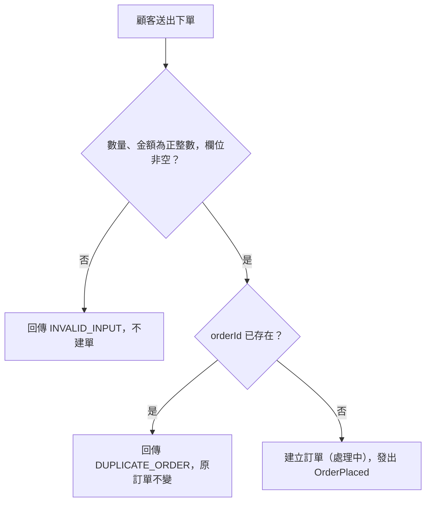

# 下單受理
- **涵蓋 rule_id**：R-EVENT_DRIVEN_ORDER-008、R-EVENT_DRIVEN_ORDER-009（起點對應 R-000）
- **確認時間**：2026-11-01 02:45

## 白話複述
1. 輸入不合法（數量或金額非正整數，或欄位為空字串）：回 INVALID_INPUT，不建單（R-008）
2. 重複 orderId：回 DUPLICATE_ORDER，原訂單不變（R-009）

## 已知取捨
- X-EVENT_DRIVEN_ORDER-001：不碰資料庫或網路
