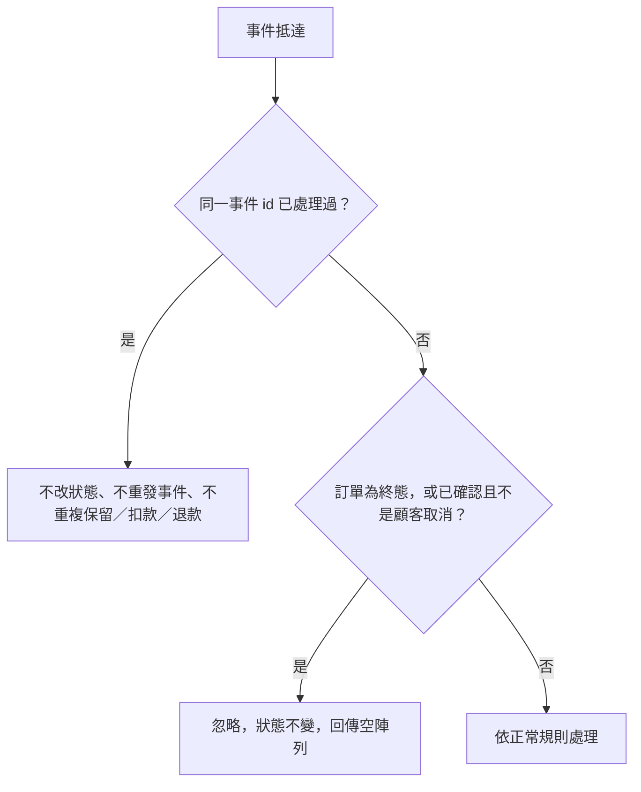

# 事件重複與亂序
- **涵蓋 rule_id**：R-EVENT_DRIVEN_ORDER-005、007
- **確認時間**：2026-11-01 02:45

## 白話複述
1. 同一事件重複送達：狀態、保留、扣款、退款都不重複（R-005）
2. 終態訂單（已取消、庫存不足、付款失敗）或已確認訂單收到非顧客取消的事件：狀態不變，回傳空陣列（R-007）

## 已知取捨
- X-EVENT_DRIVEN_ORDER-001：不碰資料庫或網路
