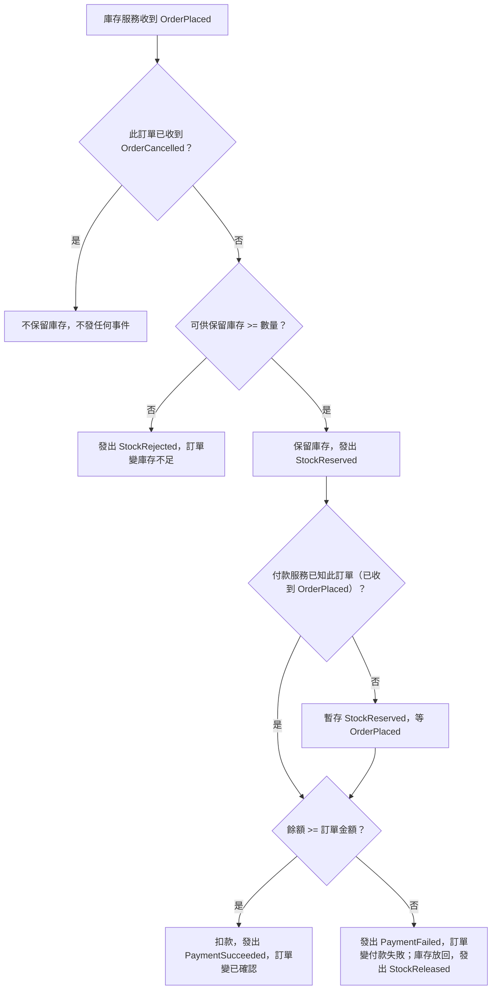

# 庫存與付款主流程
- **涵蓋 rule_id**：R-EVENT_DRIVEN_ORDER-000、001、002、013、014
- **確認時間**：2026-11-01 02:45

## 白話複述
1. 顧客下單成功：建立處理中訂單、庫存保留、扣款、訂單變已確認（R-000）
2. 庫存不足：訂單變庫存不足，不扣款（R-001）
3. 餘額不足：不扣款，訂單變付款失敗，庫存放回並發 StockReleased（R-002）
4. 付款服務先收到 StockReserved：暫存，等該訂單 OrderPlaced 到了再扣款（R-013）
5. 庫存服務已收到該訂單的 OrderCancelled，之後才收到 OrderPlaced：不保留庫存，也不發任何事件（R-014）

## 已知取捨
- X-EVENT_DRIVEN_ORDER-001：不碰資料庫或網路
