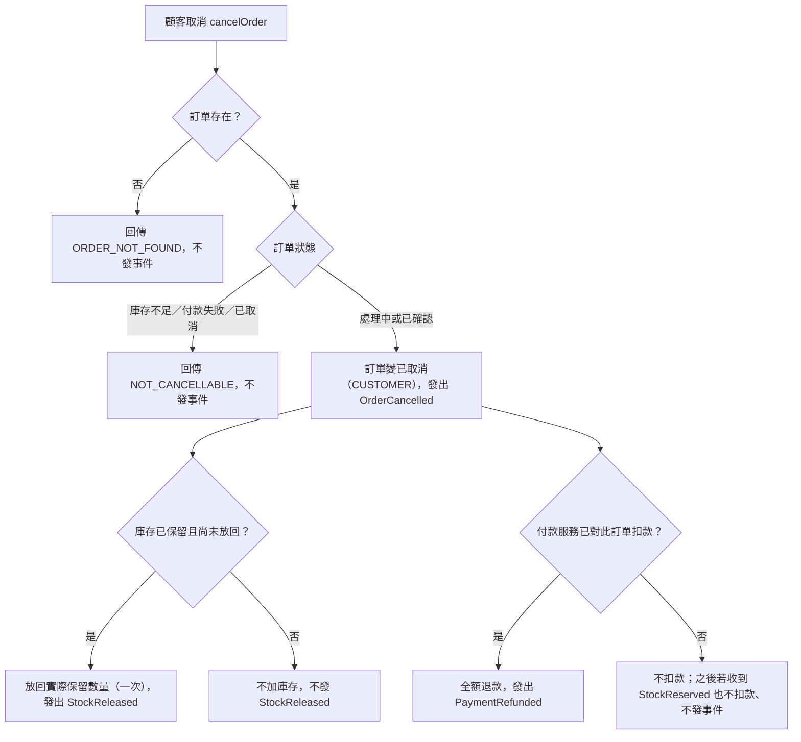

# 顧客取消
- **涵蓋 rule_id**：R-EVENT_DRIVEN_ORDER-003、006、010、011、012
- **確認時間**：2026-11-01 02:45

## 白話複述
1. 處理中訂單被顧客取消：變已取消，有保留則放回一次，若已扣款則全額退款（R-006）
2. 已確認訂單被顧客取消：變已取消，庫存放回一次，全額退款（R-003）
3. 付款服務已知訂單被取消：之後收到 StockReserved 不扣款、不發事件（R-012）
4. 庫存不足、付款失敗或已取消的訂單被取消：回 NOT_CANCELLABLE，不發事件（R-010）
5. 取消不存在的訂單：回 ORDER_NOT_FOUND（R-011）

## 已知取捨
- X-EVENT_DRIVEN_ORDER-001：不碰資料庫或網路
