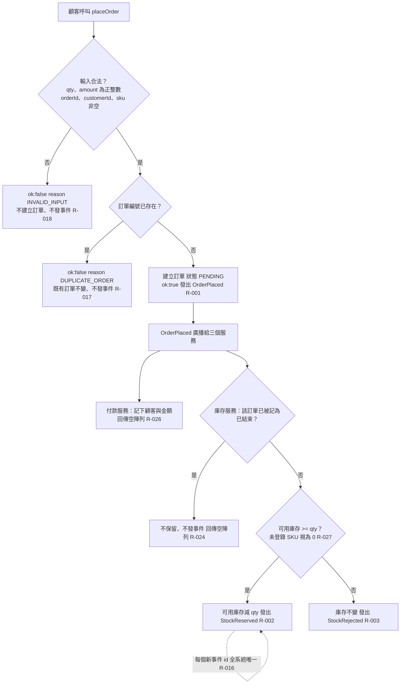

# 下單與庫存保留

顧客呼叫 placeOrder 後，訂單服務驗證輸入與訂單編號、建立「處理中」訂單並發出 OrderPlaced；庫存服務依可用庫存決定保留或拒絕，付款服務記下顧客與金額。

## rule_id
R-ORDER_SAGA-000, 001, 002, 003, 016, 017, 018, 024, 026, 027

## 流程圖

## 白話複述
1. 主流程：下單 → 庫存夠就保留 → 餘額夠就扣款 → 訂單變「已確認」（R-000）
2. 下單輸入合法且編號不重複 → 建立「處理中」訂單、發 OrderPlaced、ok:true（R-001）
3. 庫存服務收到 OrderPlaced、庫存足夠、訂單未被記為已結束 → 扣可用庫存、發 StockReserved（R-002）
4. 庫存不足（未登錄 SKU 視為 0）→ 庫存不變、發 StockRejected（R-003）
5. 每個新事件 id 全系統唯一（R-016）
6. 重複訂單編號下單 → ok:false「DUPLICATE_ORDER」（R-017）
7. qty／amount 非正整數或識別字空字串 → ok:false「INVALID_INPUT」、不建立訂單（R-018）
8. 庫存服務先收到終結事件、之後才收到 OrderPlaced → 不保留、空陣列（R-024）
9. 付款服務收到 OrderPlaced → 記下顧客與金額、空陣列（R-026）
10. getAvailable／getBalance 查未登錄 SKU／顧客 → 0（R-027）

## 已知取捨
- X-ORDER_SAGA-001 不提供資料庫持久化與網路傳輸
- X-ORDER_SAGA-002 服務之間只透過事件溝通

## 確認時間
2026-11-01 02:52（第 1 次確認即通過）
