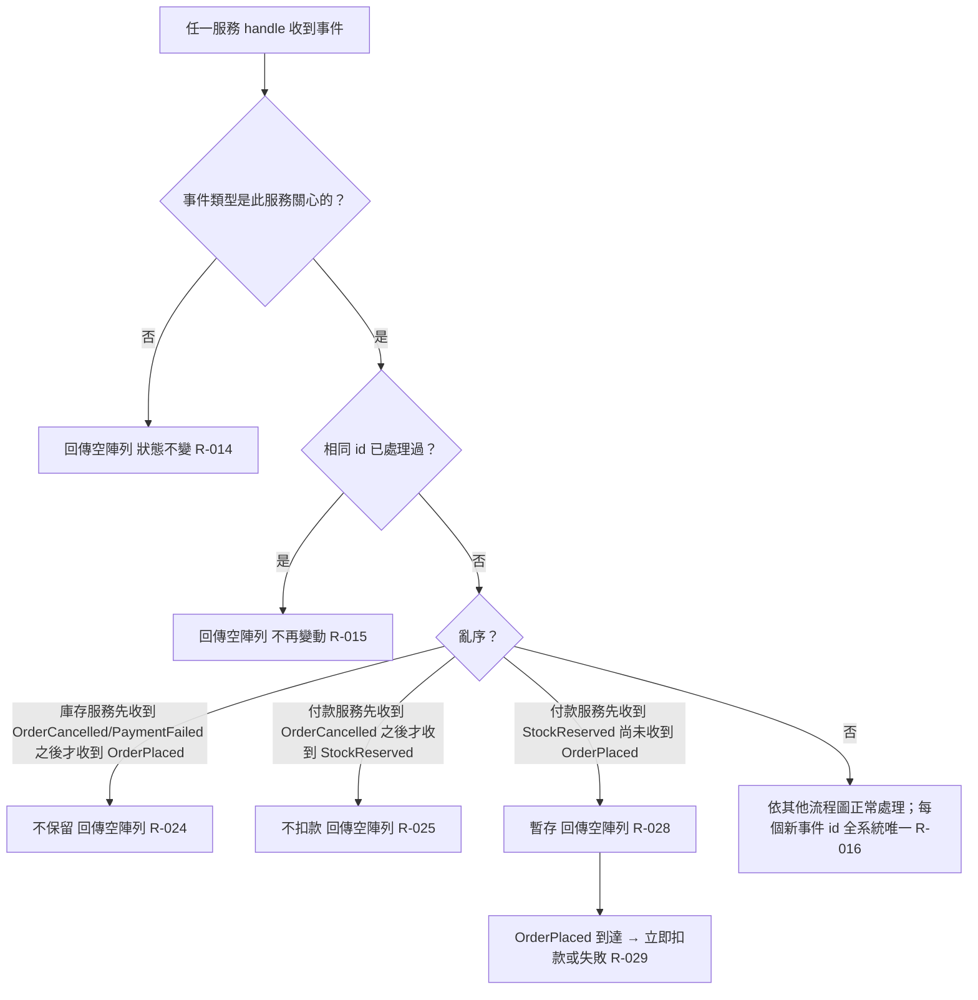

# 事件重複亂序與不關心的事件

每個事件廣播給三個服務；服務先過濾不關心的類型與重複的 id，再處理亂序（終結事件先到 → 記為已結束；中間事件先到 → 暫存）。

## rule_id
R-ORDER_SAGA-014, 015, 016, 024, 025, 028, 029；沿用 R-ORDER_SAGA-021, 022

## 流程圖

## 白話複述
1. 收到不關心的事件類型 → 空陣列、狀態不變（R-014）
2. 同一事件（相同 id）重複送達 → 不再變動、空陣列（R-015）
3. 每個新事件 id 全系統唯一（R-016）
4. 庫存服務先收到終結事件、之後才收到 OrderPlaced → 不保留、空陣列（R-024）
5. 付款服務先收到 OrderCancelled、之後才收到 StockReserved → 不扣款、空陣列（R-025）
6. 付款服務先收到 StockReserved、尚未收到 OrderPlaced → 暫存、空陣列（R-028）；OrderPlaced 到達 → 立即依餘額扣款或失敗（R-029）

## 已知取捨
- X-ORDER_SAGA-001、X-ORDER_SAGA-002（同上）

## 確認時間
2026-11-01 02:52（第 1 次確認即通過；R-028／029 為需求方授權執行者裁定的補充）
