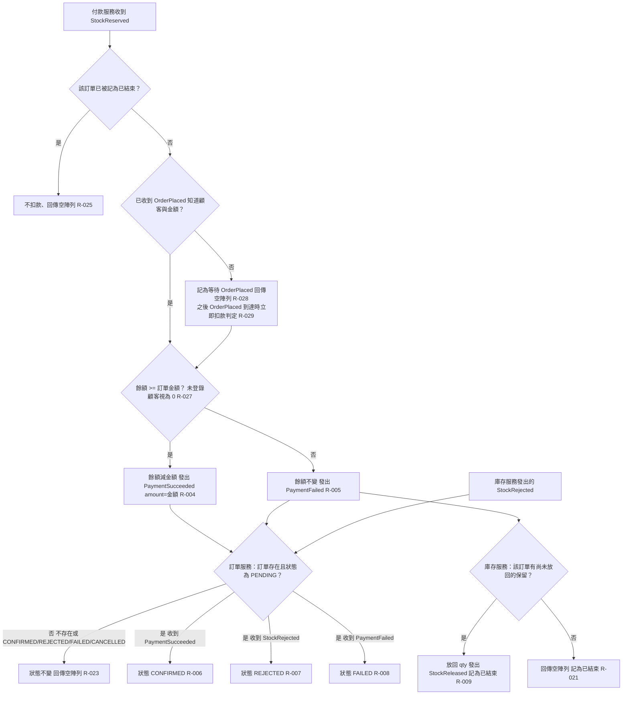

# 付款與訂單結果

付款服務收到 StockReserved 後依餘額扣款或失敗；付款失敗時庫存服務放回保留；訂單服務依結果事件把「處理中」訂單推進到已確認、庫存不足或付款失敗，非處理中的訂單不受影響。

## rule_id
R-ORDER_SAGA-004, 005, 006, 007, 008, 009, 021, 023, 025, 027, 028, 029

## 流程圖

## 白話複述
1. 付款服務收到 StockReserved、已知顧客與金額、餘額足夠、訂單未結束 → 扣款、發 PaymentSucceeded（R-004）
2. 餘額不足（未登錄顧客視為 0）→ 餘額不變、發 PaymentFailed（R-005）
3. 處理中的訂單收到 PaymentSucceeded → 已確認（R-006）；StockRejected → 庫存不足（R-007）；PaymentFailed → 付款失敗（R-008）
4. 庫存服務收到 PaymentFailed 且有保留 → 放回、發 StockReleased、記為已結束（R-009）
5. 庫存服務收到 PaymentFailed 但無保留可放回 → 不發事件、記為已結束（R-021，沿用）
6. 訂單不存在或非「處理中」收到結果事件 → 狀態不變、空陣列（R-023）
7. 付款服務先收到 OrderCancelled、之後才收到 StockReserved → 不扣款、空陣列（R-025）
8. 付款服務先收到 StockReserved、尚未收到 OrderPlaced → 暫存、空陣列（R-028）；之後 OrderPlaced 到達 → 立即依餘額扣款或失敗（R-029）

## 已知取捨
- X-ORDER_SAGA-001、X-ORDER_SAGA-002（同上）

## 確認時間
2026-11-01 02:52（第 1 次確認即通過；R-028／029 為需求方授權執行者裁定的補充）
