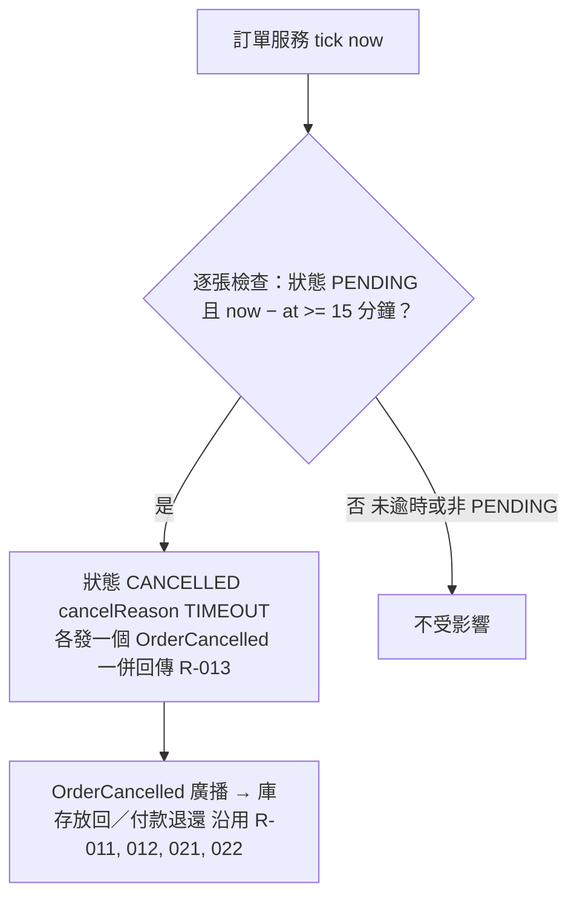

# 逾時自動取消

訂單服務 tick(now) 時，把距下單已達 15 分鐘仍「處理中」的訂單自動取消（TIMEOUT）並發出 OrderCancelled；後續放回與退還沿用顧客取消的規則。

## rule_id
R-ORDER_SAGA-013；沿用 R-ORDER_SAGA-011, 012, 021, 022

## 流程圖

## 白話複述
1. tick 時「處理中」且距下單 >= 15 分鐘 → 已取消（TIMEOUT）、各發一個 OrderCancelled；其他訂單不動（R-013）
2. 之後庫存放回／付款退還沿用 R-011、012、021、022

## 已知取捨
- X-ORDER_SAGA-001、X-ORDER_SAGA-002（同上）

## 確認時間
2026-11-01 02:52（第 1 次確認即通過）
