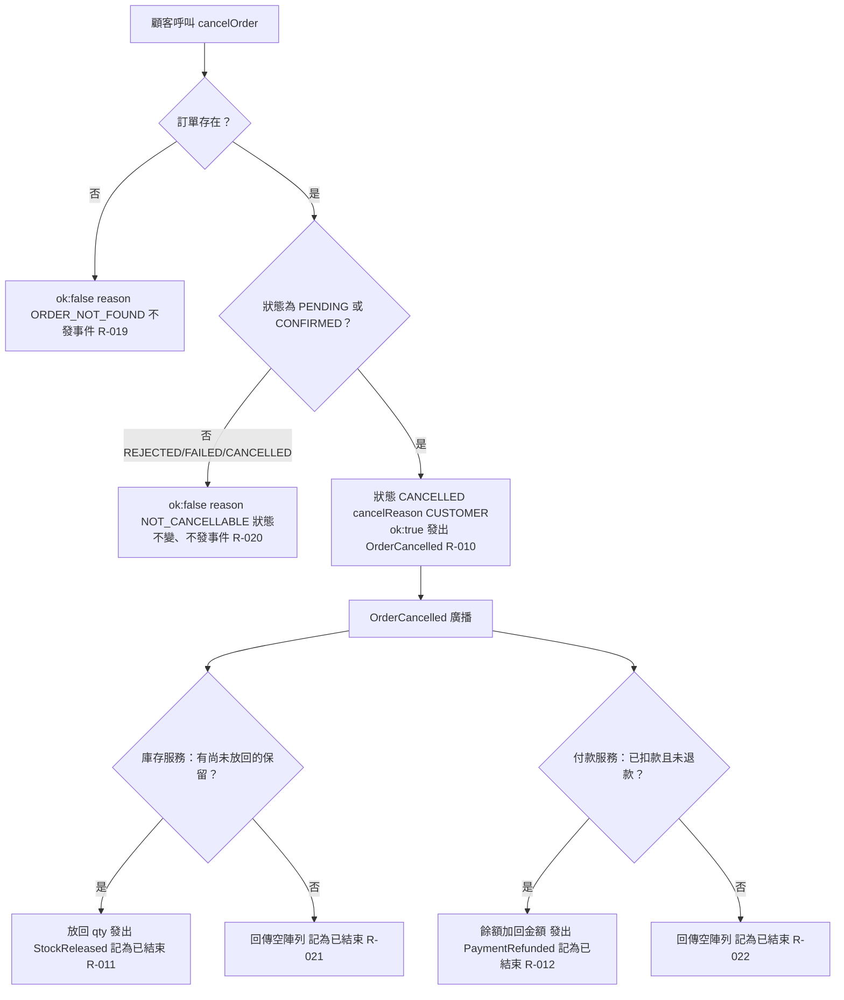

# 顧客取消與放回退還

顧客呼叫 cancelOrder；訂單存在且為處理中或已確認時取消並發 OrderCancelled，庫存服務放回保留、付款服務退還扣款。

## rule_id
R-ORDER_SAGA-010, 011, 012, 019, 020, 021, 022

## 流程圖

## 白話複述
1. 顧客取消「處理中」或「已確認」訂單 → 已取消（CUSTOMER）、發 OrderCancelled（R-010）
2. 庫存服務收到 OrderCancelled 且有保留 → 放回、發 StockReleased、記為已結束（R-011）
3. 付款服務收到 OrderCancelled 且已扣款 → 退款、發 PaymentRefunded、記為已結束（R-012）
4. 取消不存在的訂單 → ok:false「ORDER_NOT_FOUND」（R-019）
5. 取消庫存不足／付款失敗／已取消的訂單 → ok:false「NOT_CANCELLABLE」（R-020）
6. 庫存服務收到 OrderCancelled 但無保留可放回 → 不發事件、記為已結束（R-021）
7. 付款服務收到 OrderCancelled 但無扣款可退 → 不發事件、記為已結束（R-022）

## 已知取捨
- X-ORDER_SAGA-001、X-ORDER_SAGA-002（同上）

## 確認時間
2026-11-01 02:52（第 1 次確認即通過）
