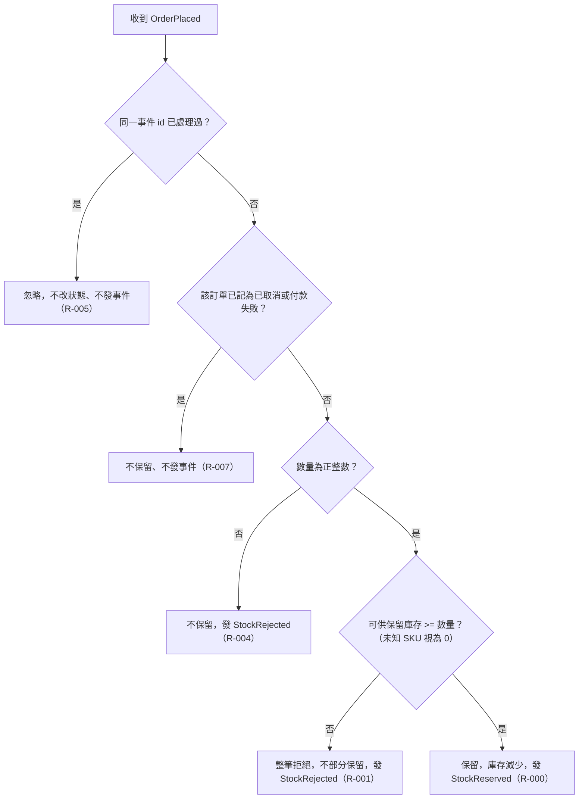

# 流程階段：下單保留

- 確認時間：2026-11-01 02:50
- Rule：R-INVENTORY-000、001、004、005、007

## 白話複述
1. 同一事件已處理過，直接忽略（R-005）。
2. 訂單已被記為取消或付款失敗，收到下單時不保留、不發事件（R-007）。
3. 數量不是正整數，不保留，回覆庫存不足（R-004）。
4. 可供保留庫存（未知商品視為 0）大於或等於數量，整筆保留並回覆保留成功；否則整筆拒絕（R-000、R-001）。

## 已知取捨
- X-INVENTORY-006 補貨、調整庫存總量（不提供功能）
- X-INVENTORY-007 已見過的事件 id 永久記住（系統無動作）
