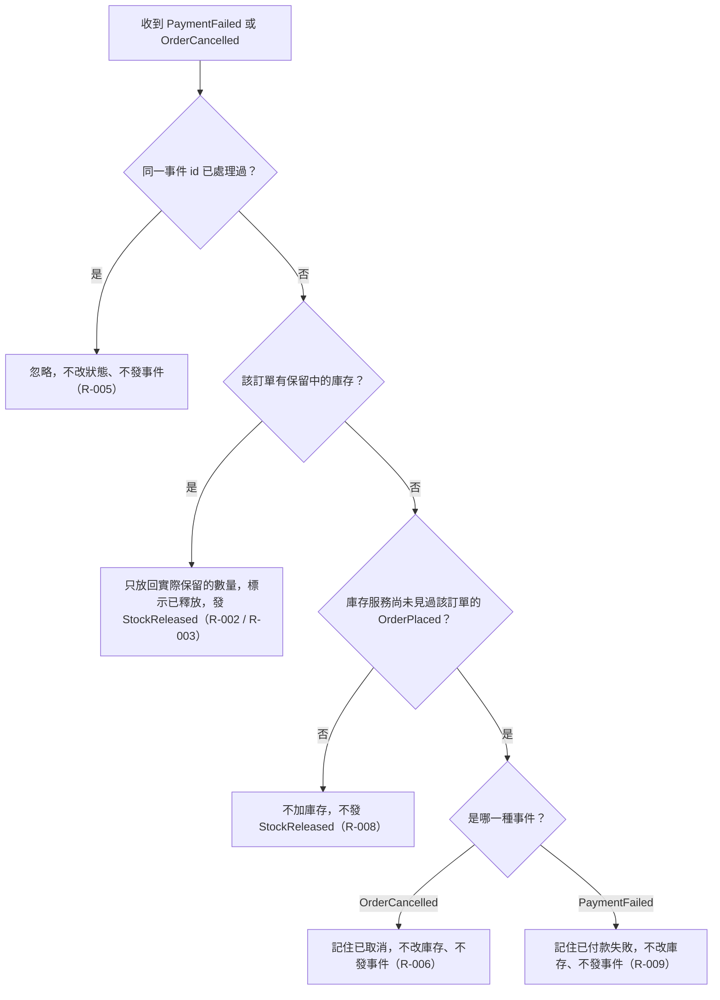

# 流程階段：付款失敗或取消時放回

- 確認時間：2026-11-01 02:50
- Rule：R-INVENTORY-002、003、005、006、008、009

## 白話複述
1. 同一事件已處理過，直接忽略（R-005）。
2. 這張訂單有保留中的庫存，就放回實際保留的數量，並回覆已放回（R-002、R-003）。
3. 沒有保留中的庫存，且已見過下單：不動庫存、不回覆（R-008）。
4. 沒有保留中的庫存，且還沒見過下單：取消先到則記住已取消，付款失敗先到則記住已付款失敗，都不動庫存、不發事件（R-006、R-009）。

## 已知取捨
- X-INVENTORY-007 已見過的事件 id 永久記住（系統無動作）
