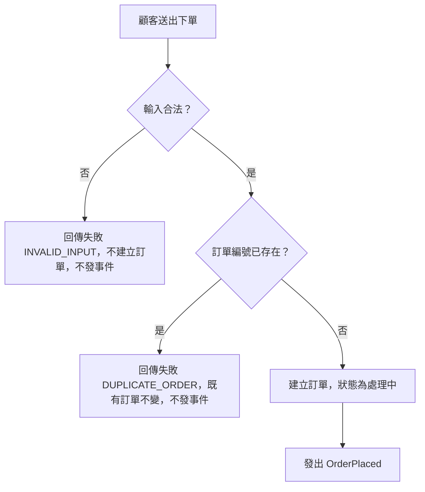

# 流程階段：下單（ORDER_SERVICE）

- 涵蓋 Rule：R-ORDER_SERVICE-000、R-ORDER_SERVICE-004、R-ORDER_SERVICE-005
- 確認時間：2026-11-01 02:50

白話複述：
  1. 輸入合法（數量、金額皆為正整數，欄位不為空字串）且訂單編號未被使用 → 建立處理中訂單，發出訂單已建立（R-000）
  2. 輸入不合法 → 失敗，不建單（R-004）
  3. 訂單編號重複 → 失敗，既有訂單不動（R-005）

已知取捨：無（本階段範圍內）
