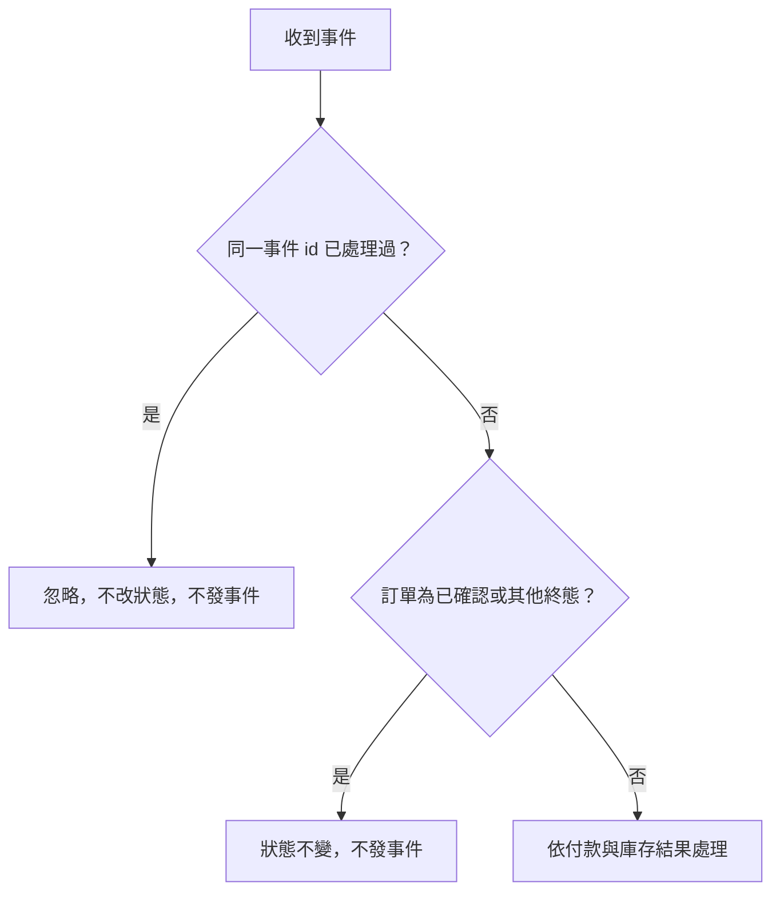

# 流程階段：事件傳遞與終態保護（ORDER_SERVICE）

- 涵蓋 Rule：R-ORDER_SERVICE-013、R-ORDER_SERVICE-014
- 確認時間：2026-11-01 02:50

白話複述：
  1. 同一事件（相同 id）第二次起 → 忽略（R-014）
  2. 已確認、庫存不足、付款失敗、已取消的訂單收到付款成功、庫存不足或付款失敗 → 狀態不變，不發事件（R-013）；取消後才到的付款成功即屬此情況，退款由付款服務依取消事件負責

已知取捨：StockReserved、StockReleased、PaymentRefunded、OrderCancelled 收到時不處理（X-ORDER_SERVICE-001、002）
