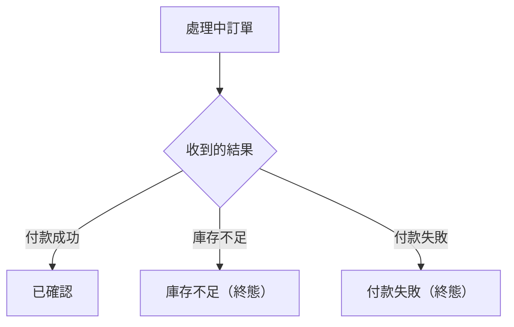

# 流程階段：付款與庫存結果（ORDER_SERVICE）

- 涵蓋 Rule：R-ORDER_SERVICE-001、R-ORDER_SERVICE-002、R-ORDER_SERVICE-003
- 確認時間：2026-11-01 02:50

白話複述：
  1. 處理中訂單收到付款成功 → 已確認，不發事件（R-001）
  2. 處理中訂單收到庫存不足 → 庫存不足，不發事件（R-002）
  3. 處理中訂單收到付款失敗 → 付款失敗，不發事件（R-003）
  （非處理中時的結果事件見「事件傳遞與終態保護」）

已知取捨：庫存放回與退款由他服務負責（X-ORDER_SERVICE-003）
