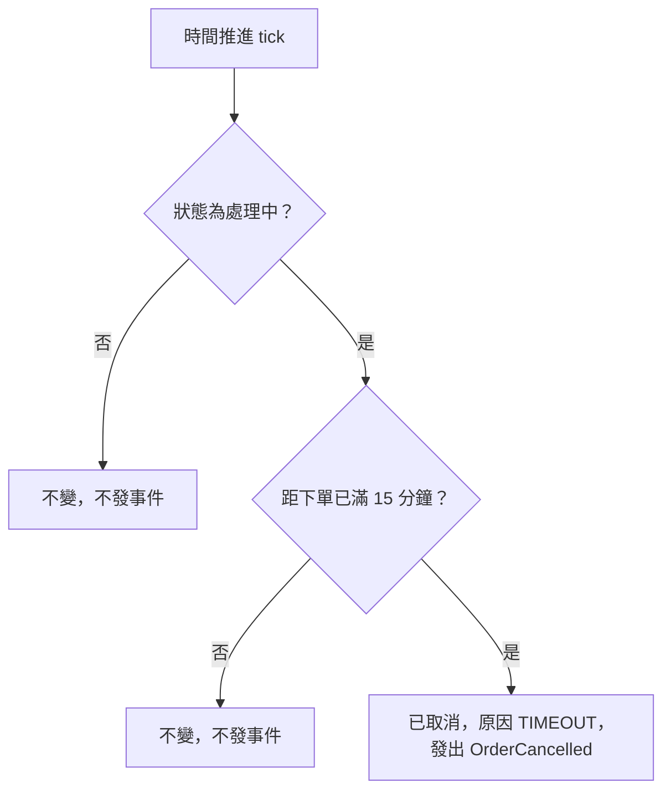

# 流程階段：逾時自動取消（ORDER_SERVICE）

- 涵蓋 Rule：R-ORDER_SERVICE-010、R-ORDER_SERVICE-011、R-ORDER_SERVICE-012
- 確認時間：2026-11-01 02:50

白話複述：
  1. 處理中且距下單滿 15 分鐘（含剛好 15 分鐘）→ 已取消，原因逾時，發出取消事件（R-010）
  2. 處理中但未滿 15 分鐘（現在時間早於下單時間也視為未滿）→ 不變（R-011）
  3. 非處理中（已確認、庫存不足、付款失敗、已取消）→ 不變，不因逾時取消（R-012）

已知取捨：無
