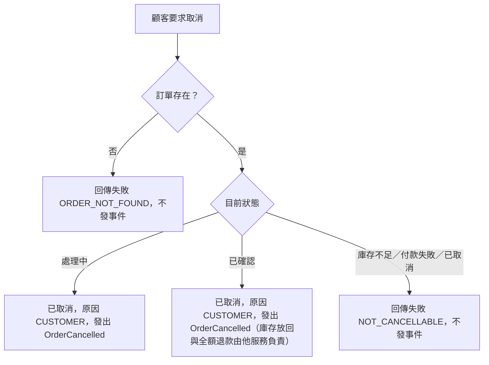

# 流程階段：顧客取消（ORDER_SERVICE）

- 涵蓋 Rule：R-ORDER_SERVICE-006、R-ORDER_SERVICE-007、R-ORDER_SERVICE-008、R-ORDER_SERVICE-009
- 確認時間：2026-11-01 02:50

白話複述：
  1. 取消不存在的訂單 → 失敗（R-009）
  2. 取消處理中訂單 → 已取消，原因顧客，發出取消事件（R-006）
  3. 取消已確認訂單 → 同上（R-007）
  4. 取消庫存不足、付款失敗或已取消的訂單 → 失敗，不發事件（R-008）

已知取捨：取消時的時間參數不寫入訂單（X-ORDER_SERVICE-004）；庫存與付款退款不屬本服務（X-ORDER_SERVICE-003）
